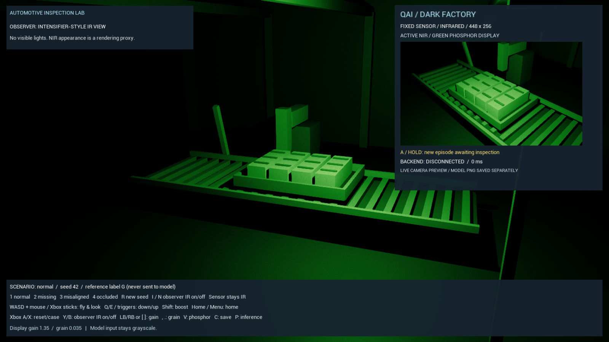

# Automotive dark factory

An Unreal Engine factory-inspection demo with **NVIDIA Cosmos-Reason2-2B**, host GPU experiments ahead of Qualcomm IQ9 EVK deployment, independent Xbox-controller navigation, and separate NIR and thermal camera views.

The current automotive demo assembles an inner trunk panel using four articulated robots. Arm A applies two continuous purple sealant runs along the front and both side contacts, leaving the rear edge free. Arm B picks up and holds the panel. Arm C/R2 uses the original gun at 70% scale, with two animated electrodes that open, clamp across the panel/frame joint, weld and release. R4 inspects with one rigid NIR/thermal camera. The fence is hidden, side fixtures are moved clear of the arms, and the panel rack restocks when the body departs. Purchased geometry, generated content, datasets and model weights remain local/private. See [pinch welding and sealant](docs/pinch_welder_and_sealant.md).

The optional [imported inspection camera](docs/inspection_camera_asset.md) replaces R4's simple prop with the locally supplied Blender camera, preserving its physical lens and sensor framing.

Each process body now retains a [source-derived mounting frame](docs/panel_mounting_frame.md), with the panel's centre cut away. Sealant is applied to this permanent metal frame; the holder brings the full replacement panel above it and lowers it into place. Earlier model scores below predate this added frame and do not establish accuracy on the new geometry.

**Editor Play or explicit `-Process` enables model-gated assembly.** One in five bodies arrives preassembled, but only fresh camera evidence selects the branch. R4 checks panel presence in NIR, sealant readiness from conducted heat on the panel surface, panel seating in NIR after installation, and weld cooldown thermally. The holder retracts only after acceptance. The preassembled branch skips assembly and seating inspection but still requires both thermal gates. HUD cards, cabinet indicators and stack lights display actual process state. See the [complete sequence](docs/process_inspection.md) and [scene implementation](docs/process_scene.md).

The command-line launcher without `-Process` keeps its repeating visual preview. Without locally prepared assets, `-Scene auto` falls back to the procedural battery-tray reference, whose mock inference and training workflow are separate. Current panel-v3 must not use the older door, parcel or battery adapters. NIR and thermal are rendering approximations, not calibrated cameras; the panel model has not yet been deployed to IQ9.

The layout retains six welds across the two front contact flanges, with no
extension rod or rear-middle support. EVK props mount directly to the base covers.
Generated black contact backings are removed; 4 mm rounded purple sealant sits
under a panel raised 5 mm. The thermal camera reads heat conducted into the
opaque panel, rendered as bounded GPU contact bands. See
[panel contact heat](docs/panel_contact_heat.md) and the
[current model status](docs/model_classification.md). Previous exposed-sealant
results retain their [historical scope](docs/model_classification_perimeter_history.md).
The selected host routes weld checks to a dedicated adapter and the other stages
to the newer primary adapter: 191/192 development decisions, one conservative
cool-sealant hold, and no premature approvals. Actual model integration completed
all three bodies and six thermal acceptance checks in 183 seconds.


## Historical three-contact model results — 14 September 2026

The selected `panel-two-bead-shared-256-v3` adapter completed 256 total optimizer updates across two runs and was saved at **18:10 CEST**. Logged optimization took **12 min 23 sec**; scene preparation, capture, evaluation and integration checks are separate work. The frozen adapter was promoted to the local host endpoint on port **18191** after validation.

| Evidence | Result |
| --- | --- |
| Data | 64 whole-body episodes; 40 train / 12 validation / 12 test |
| Images | 320 train / 96 validation / 96 test batches, each with three lossless 448 × 256 grayscale PNGs |
| Exact serving-runtime validation | 95/96 labels; 96/96 gate actions |
| One-time held-out test | 95/96 labels/actions; one conservative cool-weld hold, no false releases or wrong panel branches |
| Host HTTP latency, median / p95 | 49.28 / 54.55 ms standalone; 84.43 / 92.83 ms during the rendered integration run |
| Native integration | Assembly / preassembled / assembly completed; 30 model requests and all six thermal acceptance audits passed |

These are small simulated-camera experiments, not real-factory or EVK validation. Timings cover the model HTTP request, not arm travel, scanning, cooling or full-cycle throughput. [Model training and evaluation](docs/model_classification.md) records exact provenance, commands and remaining limits. Earlier shared320 results belong to the [previous three-bead scene](docs/model_classification_panel_v2_history.md).

## Run the panel demo on a prepared installation

The commands below assume the [Unreal build](#quick-start-on-windows), [local asset import](#import-the-local-welding-cell), and [host environment plus compatible adapter](docs/model_classification.md#selected-host-runtime) are already prepared. A fresh checkout does not include the private assets or checkpoint.

First check `http://127.0.0.1:18191/health` and reuse a healthy compatible host. When it is stopped, start it from the repository root through PowerShell:

```powershell
wsl.exe bash scripts/model/start_host_service.sh --port 18191 --adapter checkpoints/panel-contact-shared-960-v7 --weld-adapter checkpoints/panel-contact-shared-896-v6 --linear-patch-embedding
```

This starts the WSL systemd user service `dark-factory-panel-model.service`, which survives closing its launch terminal or Codex for the current WSL session. It is not configured to start after a Windows reboot or WSL shutdown. The launcher accepts `DF_MODEL_PYTHON`, `DF_BASE_MODEL` and `PYTHONPATH` environment overrides and refuses an existing unit or occupied port. Wait for model loading, then check readiness and launch the bright observer view:

```powershell
Invoke-RestMethod http://127.0.0.1:18191/health
.\unreal\Scripts\run.ps1 -Scene welding -Process -ProcessObserverMode 3 -ProcessEndpoint http://127.0.0.1:18191/v1/inspect
```

Interactive launches default to a **borderless 2560 × 1440 window**. Override
the size with `-Width 1920 -Height 1080`. Automated capture and smoke fixtures
retain their established 1600 × 900 default.
V-sync is enabled for interactive launches; the existing 60 FPS cap is retained.

For OBS, use **Window Capture → Windows 10 (1903 and up)** with the
`DarkFactory` window and **Client Area** enabled, then **Transform → Fit to
Screen**. This captures the borderless DX12 window at 2560 × 1440 while keeping
DLSS/Lumen enabled. See [OBS capture setup](docs/observer_graphics.md#obs-capture).

The health response must report `ready` and `automotive-panel-process-v3`; the model guide records the selected adapter identity. If the compatible server is already running, reuse it. `-Process -NoInference` allows exploration with model gates held. Use `-Scene welding` without `-Process` for the separate repeating visual preview. Escape quits the demo. An unavailable host holds the process; it does not mean the saved training was lost. Inspect or explicitly stop this service with:

```powershell
wsl.exe systemctl --user status dark-factory-panel-model.service
wsl.exe journalctl --user -u dark-factory-panel-model.service -n 80 --no-pager
# Stop only when finished with model inference:
wsl.exe systemctl --user stop dark-factory-panel-model.service
```

The foreground alternative remains `bash scripts/model/start_host.sh` with the same model arguments; keep its WSL terminal open and use Ctrl+C there to stop it. See [host lifecycle and troubleshooting](docs/model_classification.md#host-service-lifecycle) for details.



## Open in Unreal Editor

Open `unreal/DarkFactory.uproject`. The startup map is now
`/Game/Maps/DarkFactoryPanel`, which displays the current assembly cell before
Play. Press **Play** to run the current panel process in the bright observer
view, using the same host endpoint on port 18191 described above.

The Outliner contains **Dark Factory - current panel assembly preview**. Select
it to change the preview pose or use **Refresh Preview** after an asset reimport.
The preview is regenerated from the production scene builders; edit those
sources for lasting layout changes. See the [Editor workflow](docs/unreal_editor.md)
for map regeneration, Play/Stop behavior and troubleshooting.

## Quick start on Windows

Requirements: Unreal Engine 5.8 with C++ build tools and Python 3.11+. The recorded development host uses UE 5.8.1 and an RTX 5090. Model fitting/serving additionally needs the CUDA/WSL environment described in the [model guide](docs/model_classification.md); the procedural mock requires no model GPU.

From the repository root, prepare the Python environment:

```powershell
python -m venv .venv
.\.venv\Scripts\python.exe -m pip install -e .
```

For supported NVIDIA hardware, optionally install the pinned [DLSS dependency](docs/observer_graphics.md) with `.\unreal\Scripts\setup_dlss.ps1` before building. Build the Unreal module and generate its map, factory materials and sensor shaders:

```powershell
.\unreal\Scripts\build.ps1
```

For the automotive scene, continue with [local asset import](#import-the-local-welding-cell), then [start the panel demo](#run-the-panel-demo-on-a-prepared-installation). To try the procedural reference without purchased assets, start a mock bridge in one terminal. This sequence exercises the three reactions; it does not inspect the image:

```powershell
.\.venv\Scripts\python.exe -m dark_factory.bridge --mock-cycle G,A,R
```

Open the procedural reference scene in another terminal:

```powershell
.\unreal\Scripts\run.ps1 -Scene procedural
```

Reset or change the scene to start a new inspection. Use `run.ps1 -Scene procedural -NoInference` to explore the reference camera and collect samples without a bridge. Both scripts accept `-EngineRoot` if Unreal is installed elsewhere.

In the procedural scene, two roof-window light proxies provide dim visible fill, initially **56 lumens each** (70% of the nominal 80-lumen setting). Tune the nominal setting with `run.ps1 -Scene procedural -NoInference -RoofLightLumens 80`; it is not a measured factory illumination level. `-RoofLightLumens 0` removes the roof fill; also turn off the observer headlamp with L for a zero-light visible comparison. Offline dataset capture, `-Smoke` and `-NightVisionSmoke` explicitly disable both roof fill and the headlamp for calibration.

Capture the visible/NIR/thermal comparison with Unreal’s native viewport screenshot path:

```powershell
.\unreal\Scripts\run.ps1 -ModalityScreenshots -NoInference -Output artifacts\modalities
```

The sequence saves visible, green/monochrome NIR, and white-hot/black-hot/iron thermal screenshots from one fixed viewpoint, plus `modalities.json`. It also compares saved NIR and thermal sensor PNGs with roof lighting off/on. Check the report for the outcome. After capture, the simulator stays open in thermal view with inference paused.

## Import the local welding cell

Place the purchased FBX and JPEGs in `assets/Autodesk_FBX_2009/`. The entire `assets/` tree is ignored. The following commands build a small preparation tool against Unreal's installed FBX SDK, recover connected pieces and approximate robot joints, export grouped geometry, and import separate static meshes:

```powershell
.\.venv\Scripts\python.exe -m pip install -r scripts\assets\requirements.txt
.\scripts\assets\prepare_welding_cell.ps1 -Python .\.venv\Scripts\python.exe
.\unreal\Scripts\import_welding_cell.ps1 -Mode prepared -Manifest assets\derived\welding_cell\manifest.json
.\unreal\Scripts\run.ps1 -Scene welding
```

The current preparation produces 91 source mesh components plus three auxiliary pinch-gun pieces and one copy of a blue rack H-bar for the panel gripper, including 29 body-panel pieces and two complete moving holders, plus 24 joints across four robots. The separate visual-preview mode repeats a 21-second arrival, approach, precision-welding, withdrawal and departure cycle, with seeded per-robot rest delays of 0.2-0.8 seconds and pre-weld dwells of 0.5-2 seconds. Arms park with their bases turned 180 degrees away and approach/withdraw in one second. Physics strip curtains align with the rail ends and conceal the entry/exit tunnels; articulated spline hoses follow the arms. Burst, fountain and falling-fragment phases share a bounded 4,096-fragment pool, with an additional 128-puff optical smoke pool. Sparks bounce against surfaces, settle and fade, with visible/NIR illumination and independent thermal cooling profiles. See [production cycle, effects and controls](docs/welding_production_cycle.md) for the authored motion and physics assumptions. Four car-weld spots heat and cool on three body panels in visible, NIR and thermal views, following the moving car and resetting for each new body. These authored surface fields are independent of the tools' retained heat; see [car-weld heat](docs/welding_body_heat.md). Twenty-eight warm robot castings also use authored mesh-local thermal gradients; [imported thermal fields](docs/imported_thermal_fields.md) explains their shape and limits. The imported bulk heat-transfer network remains disabled.

Ten [researched realism additions](docs/realism_additions.md) add floor markings, overhead utilities, extraction hoods, animated body clamps, a stack light, entry/exit presence sensors, spatial machinery sound, production progress, five smooth observer viewpoints and persistent weld witness marks. **B / Xbox X** cycles viewpoints; **M** mutes sound. The existing control cabinet now has an [illuminated LCD and LED buttons](docs/control_cabinet.md), with GPU gauges driven by the simulated production cycle. In the default visual cycle these details follow the authored schedule. In process mode the cabinet, stack lights and HUD show actual gate-controller status, with explicit labels for offline capture and policy tests.

`run.ps1` defaults to `-Scene auto`: it selects the prepared local cell when available, otherwise the procedural reference. `-Scene welding` requires a valid local manifest and meshes. Use **Space / Xbox View** to pause or resume the car, robot, particle and curtain motion; observer movement and modality switching remain independent. The six visible roof-light proxies are adjustable with `-WeldingRoofLightLumens` (default 80 each). The fixed NIR camera retains its own illumination. The sensor panel shows colored thermal and monochrome thermal together, sharing one camera render. The observer defaults to the iron color palette when entering thermal; K / Xbox D-pad left retains white-hot and black-hot options.

Run the imported visual/motion and camera-isolation check:

```powershell
.\unreal\Scripts\run.ps1 -Scene welding -WeldingSmoke -Output artifacts\welding-smoke
```

See [asset preparation, geometry and validation](docs/welding_cell_asset_import.md) for the source structure, local reports and limitations. Existing procedural smoke/dataset flags retain the procedural scene.

Visible observer views enable [DLSS Quality and Lumen hardware ray tracing](docs/observer_graphics.md) when supported. NIR and thermal observer modes suspend these effects, and all fixed/model cameras keep their independent raster capture settings. Install the official UE 5.8 plugin locally with `unreal/Scripts/setup_dlss.ps1`, then rebuild; third-party plugin files remain ignored.

## Controls

Navigation, observer modalities and graphics controls work independently of model inspection. Procedural case selection, legacy NIR capture/inference controls and bulk heat exchange remain disabled in the imported cell. Imported `-Process` uses its own four-stage capture/controller; imported visual-preview mode follows its separate authored cycle.

| Input | Action |
| --- | --- |
| Xbox left / right stick | Fly / look |
| Xbox triggers | Down / up |
| Xbox A / X | Procedural scene: reset with new seed / next case |
| B / Xbox X | Imported scene: cycle five observer viewpoints; manual flight cancels the transition |
| M | Imported scene: mute / unmute synthesized factory sounds |
| F6 | Toggle visible-observer NVIDIA DLSS Quality (requires the official compatible plugin and supported GPU) |
| F7 | Toggle visible-observer Lumen indirect lighting and reflections |
| F11 | Toggle Lumen hardware ray tracing; off uses software Lumen when available |
| F8 / Xbox left-stick click | Observer collider overlay: off → physics bodies → physics + query bounds → off |
| Tab / Xbox Y | Cycle observer: dim visible → NIR → thermal → bright factory → dim visible |
| I / N / Xbox B | Toggle observer NIR / dim visible |
| T | Toggle observer thermal / NIR |
| Xbox Menu | Return observer home |
| Escape | Quit the demo immediately |
| Space / Xbox View | Pause / resume the imported production cycle and physics |
| L | Toggle headlamp preference; it emits only in dim visible mode and resumes there when requested |
| WASD + mouse; Q / E | Fly at 900 cm/s and look; inverted mouse pitch; down / up |
| Shift / Home | Boost to 2700 cm/s / return observer home |
| 1 / 2 / 3 / 4 | Procedural: normal / missing / misaligned / obscured |
| R | Procedural: reset current case with a new random seed |
| V | Toggle NIR green phosphor / monochrome display |
| K / Xbox D-pad left | Cycle thermal white-hot / black-hot / iron-like palette |
| H / Xbox D-pad right | Procedural: next thermal case |
| J / Xbox D-pad up | Procedural: spatial thermal fields / uniform comparison |
| U / Xbox D-pad down | Procedural: advance thermal time by 15 seconds (wrap after 1800) |
| O | Procedural heat exchange (default on) / legacy isolated cooling |
| F9 | Queue raw thermal PNG + metadata snapshot |
| Xbox LB / RB or [ / ] | Decrease / increase NIR display gain |
| Comma / period | Decrease / increase NIR display grain |
| C / P | Procedural: queue a fresh NIR PNG + metadata capture / toggle NIR inference |

Bright factory mode starts the grouped overhead lamps with a brief staggered flicker, then settles to steady illumination. It suppresses the observer headlamp while retaining its preference for the return to dim mode. Both fixed infrared cameras keep their own inputs. See [factory lighting and its isolation checks](docs/factory_lighting.md).

The fixed NIR sensor stays in active-IR mode during the interactive demo. The HUD shades its render target directly on the GPU, with a default sensor refresh of 15 Hz. In the procedural reference, this preview precedes CPU sensor augmentation and is not an exact copy of the saved/model PNG. Imported model captures use their fixed GPU grayscale pass; R4 stage snapshots follow the settled-pose inspection schedule instead of the background preview refresh. Display gain, grain and color leave those PNGs unchanged. Moving the observer or switching its modality does not change the fixed sensor.

The default NIR display shader uses one texture sample. Launch with `run.ps1 -NightVisionQuality` for an optional five-sample halo. Palette and grain run on the GPU; the animated grain pattern changes at 24 Hz. Live inference and saves use one asynchronous GPU readback job at a time, followed by grayscale augmentation and PNG encoding on a CPU worker. Offline dataset capture remains synchronous for determinism. [The night-vision guide](docs/night_vision.md) describes the controls and capture settings.

The observer thermal view is fixed at 0-120 C, with white-hot, black-hot and iron palettes. F10 and right-stick range switching are removed. Fixed/model thermal cameras retain their independent 20-120 C encoding; 120+ marks saturation, so hotter welding surfaces share the endpoint color.

The fixed thermal sensor has a separate 10 Hz GPU preview and linear 448 × 256 grayscale output over 20–120 °C apparent temperature. CPU profile updates integrate Planck radiance over 8–14 µm, mix emissivity with reflected ambient radiance, and upload a small lookup texture. A GPU depth check rejects hidden surfaces; observer palettes do not alter saved thermal pixels. F9 saves snapshots in `unreal/Saved/Thermal/`. In the procedural reference only, a small energy-conserving network adds contact conduction, distance-dependent radiation and retained surface warmth after a source moves. O toggles exchange; U advances simulated time. H cycles to a source/receiver fixture and frames it with the observer. Imported body, sealant, weld and tool heat use authored surface fields; imported bulk exchange stays disabled. The updated thermal GPU smoke passes 138 transfer checks plus 42 existing and 55 spatial-field checks; sustained GPU costs have not yet been measured. See [thermal rendering and controls](docs/thermal_rendering.md).

In the procedural NIR bridge, G releases the tray, A holds it, and R engages the reject gate. Panel-process letters have stage-specific meanings: presence R selects assembly, seating R is an exception, and thermal R waits. All uncertain, invalid, expired or obsolete replies hold; see the [gate policy](docs/process_inspection.md).

Collider bounds draw through surfaces in the observer HUD across all four modalities. Green identifies static collision, cyan kinematic colliders, orange dynamic bodies, and purple query-only mesh bounds. Hidden active carriage boxes are included; disabled collision disappears immediately. Mesh bounds enclose their collision geometry and are not exact box-shaped colliders. See [collider overlay](docs/collider_overlay.md).

## Dataset and training preparation

The current automotive workflow captures both NIR and thermal under `automotive-panel-process-v3`, with three physical R4 views per stage and whole-body episode splits. A shared multimodal LoRA is fitted with `scripts/model/train_lora.py`; exact-runtime validation precedes a frozen, one-time held-out evaluation. The completed two-bead dataset has 512 batches / 1,536 PNGs. Use the [panel capture instructions](docs/process_inspection.md#capture-and-timing) and [model workflow](docs/model_classification.md) to reproduce it. Changing geometry, camera recipes, prompts or sensor encoding requires compatible new data and evaluation.

The following commands apply only to the separate procedural single-camera NIR reference. Its generic thermal snapshots do not feed this training path:

```powershell
.\.venv\Scripts\python.exe scripts\training\prepare.py plan --output data\pilot\plan.jsonl
.\unreal\Scripts\run.ps1 -Plan data\pilot\plan.jsonl -Output data\pilot
.\.venv\Scripts\python.exe scripts\training\prepare.py validate --manifest data\pilot\manifest.jsonl --dataset-root data\pilot
.\.venv\Scripts\python.exe scripts\training\prepare.py freeze --manifest data\pilot\manifest.jsonl --dataset-root data\pilot --output artifacts\pilot-frozen
```

The default plan has 300 captures across 100 matched nuisance families; it is a starter dataset size, below the proposed final evaluation gates. Whole families stay in one split. Inspect the actual images before using the data.

Run a CPU-only training preparation check:

```powershell
.\.venv\Scripts\python.exe scripts\training\train_lora.py --manifest data\pilot\plan.jsonl --dataset-root data\pilot --output outputs\factory-lora --dry-run
```

See [training and export](docs/training.md) for processor validation, optional CUDA dependencies, LoRA training and IQ9 release gates. That procedural training script uses exactly one supervised class token and freezes the vision tower. The separate [automotive process pipeline](docs/model_classification.md) uses new multimodal LoRA experiments and host GPU evaluation. LoRA alone does not guarantee lower inference latency.

## Connect a prepared IQ9 candidate

This is the procedural single-camera bridge. The automotive process contract is currently host-only and must not be routed through it. Use the address and model ID of a separately prepared **new procedural factory candidate**. This starts only the local bridge; it does not modify the EVK service:

```powershell
.\.venv\Scripts\python.exe -m dark_factory.bridge --backend evk --evk-url http://YOUR_EVK_IP:18183 --model YOUR_FACTORY_MODEL_ID
```

The bridge sends a direct embedded 448 x 256 lossless PNG, one versioned user prompt, and requests one deterministic G/A/R token. The old parcel adapter uses different labels and is not a factory classifier. [Bridge configuration and protocol](docs/bridge.md) cover timeouts and compatibility.

## Checks and tutorial

For the current panel scene, use fresh output directories. The first command checks controller policy without model calls; the second needs the compatible host and tests the physical camera-to-model sequence. Graphics parity is separate from model accuracy.

```powershell
.\unreal\Scripts\run.ps1 -ProcessPolicySmoke -Output artifacts\panel-policy-check
.\unreal\Scripts\run.ps1 -ProcessSmoke -ProcessEndpoint http://127.0.0.1:18191/v1/inspect -Output artifacts\panel-model-check
.\unreal\Scripts\run.ps1 -GraphicsSmoke -Output artifacts\observer-graphics-check
```

For the CPU suite and procedural rendering references:

```powershell
.\.venv\Scripts\python.exe -m unittest discover -s tests -v
.\unreal\Scripts\run.ps1 -Smoke -Output artifacts\render-smoke
.\unreal\Scripts\run.ps1 -NightVisionSmoke -Output artifacts\night-vision-smoke
.\unreal\Scripts\run.ps1 -ReadbackSmoke -Output artifacts\readback-smoke
.\unreal\Scripts\run.ps1 -ThermalSmoke -Output artifacts\thermal-v1
```

- [Full tutorial](docs/dark_factory_tutorial.md)
- [Panel process setup and gates](docs/process_inspection.md)
- [Model training, results and host serving](docs/model_classification.md)
- [Panel geometry, tools and motion](docs/process_scene.md)
- [Observer DLSS, Lumen and hardware ray tracing](docs/observer_graphics.md)
- [Fixed observer thermal display and hot-weld saturation](docs/thermal_welding_range.md)
- [Night-vision shaders, controls and limitations](docs/night_vision.md)
- [Bright factory lighting and startup checks](docs/factory_lighting.md)
- [Thermal rendering, sensor encoding and controls](docs/thermal_rendering.md)
- [Heat-transfer model and rendered evidence](docs/thermal_heat_transfer.md)
- [Rendered thermal QA](docs/thermal_qa.md)
- [Thermal implementation research](docs/thermal_rendering_research.md)
- [Infrared research and shader design](docs/infrared_research.md)
- [Existing implementations and performance techniques](docs/night_vision_implementations.md)
- [Rendered night-vision QA](docs/night_vision_qa.md)
- [Scenario and asset selection](docs/scenario_design.md)
- [Validation evidence](docs/validation.md)
- [Precursor: IQ9 Physics Reasoning](https://github.com/eivholt/qai-physics-reasoning/blob/main/docs/isaac_sim_conveyor_reason2_tutorial.md)

Generated Unreal content, captures, datasets, model weights and licensed assets are ignored by Git. Source scripts recreate the starter content.

The welding tools now cool in visible, NIR and thermal views after each weld. See the [tool-cooling guide](docs/welding_tool_cooling.md).
