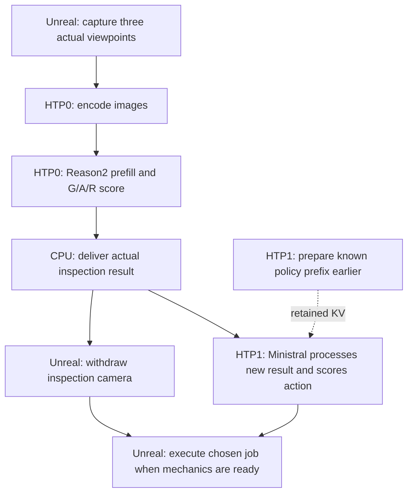

# Scheduling the dark factory across two HTP devices

September 21, 2026 follow-up to [device placement](npu_device_placement.md).
The useful next gains come from doing real input preparation earlier and reducing
work on the path that delays a robot job. Merely loading two models on separate
accelerators does not remove dependencies between their answers.

This investigation adds a private, bounded prefix-preparation experiment and
analyzes the previous actual Unreal trace. It does **not** change production
workers, launch defaults, prompts, acceptance thresholds or scene behavior.
No new rendered integration or model accuracy result is claimed.

## What the devices are

The EVK runtime exposes two HTP devices, numbered 0 and 1, each with core 0.
These are independently addressable Hexagon inference accelerators in the same
IQ9 system, not two computers or two model slots. The separate placement tested
here is:

| Resource | Work in the split-device candidate |
| --- | --- |
| Host PC GPU | Unreal rendering; alternatively the host model backend |
| EVK CPU | Services, tokenization, image preparation, scheduling and result handling |
| EVK HTP device 0 | Reason2 image encoder and text decoder, using the stage-selected adapted bundle |
| EVK HTP device 1 | Compiled Ministral prompt processing and action scoring |

The original CPU Ministral service stays available as a fallback and is still
the normal launch selection. An NPU candidate needs explicit startup and routing;
the existing F4 EVK preset does not silently enable it.

HTP0 and HTP1 have separate execution resources and local fast memory, but share
system memory, memory bandwidth and system power/thermal limits. Actual device
handles, not config names alone, established the placement in the preceding
study. Neither experiment measures per-kernel utilization or energy.

Qualcomm's [FactoryPulse example](https://www.qualcomm.com/developer/blog/2026/07/genai-rag-iq9075-factorypulse)
also distributes an LLM, embedding model and speech recognizer over the IQ9075's
two HTP resources. Our runtime inventory and measurements establish the behavior
of this particular EVK; the example does not establish our performance.

## Weights, graphs and working memory

Weights are the learned parameters. Loading a model makes its compiled graphs,
weights and runtime buffers available for execution; it does not mean that all
weights live permanently in the accelerator's small local fast memory. The
runtime moves/reuses working data as kernels execute.

Activations are intermediate results for the current input. The decoder's KV
cache holds attention state for an already processed token prefix. Reusing an
exact prefix can avoid repeating its computation, without changing or training
the weights. That cache belongs to a compatible model and conversation: it is
not interchangeable between Reason2 and Ministral, between different adapters,
or between unrelated images/histories.

The current Reason2 NPU deployment has **two complete adapted bundles**:
`primary` serves panel presence, sealant temperature and panel seating; `weld`
serves weld temperature. These names describe stage routing, not HTP numbering.
The LoRA changes are incorporated into separate exports; this path does not
load one shared base and cheaply swap small adapter matrices on every request.
Do not assume that their image encoders have identical weights either.

Together with compiled Ministral, that is three resident compiled model
instances on two accelerators, representing two model families. The retained
CPU fallback is another resident instance. The previous split-device snapshot
reported 15,508 MiB available and no swap out of 35,192 MiB total. This is measured
headroom for that configuration, not a maximum model count.

Qualcomm supports compatible weight-shared multi-graph contexts through
[compile-and-link APIs](https://workbench.aihub.qualcomm.com/docs/hub/generated/qai_hub.submit_compile_and_link_jobs.html).
This is a possible memory optimization, not automatic weight sharing between
our current processes, and it does not merge their KV state or guarantee parallel
execution. No upload or shared-weight export was performed in this investigation.

## The inference dependency chain

The current Reason2 path sends **three separate image inputs to one joint
classification**. It does not classify each camera independently and vote.
The fixed 448 x 256 encoder produces 112 visual tokens per image, 336 in total.
The text decoder consumes their embeddings and the trained prompt in order.
Its final full-vocabulary logits give the next-token result; the G/A/R contract
and confidence checks remain unchanged.

The main inference stages are image/text preparation, vision encoding when
applicable, decoder prefill, then output scoring. Ordinary generation would
continue with repeated dependent next-token steps. Our one-token decisions
avoid that long output loop, but still need to process the input. Decoder layers
and successive output tokens have dependencies even though the hardware
parallelizes many operations within a layer.

Both Reason2 vision and its text decoder currently execute on HTP0. Its compiled
text parts are not automatically distributed across the two devices. Moving
one model to HTP1 does not make one request use both accelerators.

### What can overlap

- Preparing known policy text or the already chosen action's message envelope
  while a physical job or actual Reason2 inspection runs. Never fill in a future
  observation with a guessed G/A/R result.
- Rendering, heat evolution, allowed mechanical movement and independent
  inference, subject to the existing pause and collision/serial-motion rules.
- Agent inference after a real result and camera withdrawal. This already
  happens in the demo; dispatch waits for the camera to park.
- Independent requests from different cells or background models on separate
  devices, with bounded queues and separate request state.
- Potentially encoding each image immediately after capture while R4 moves to
  the next view. This requires a new incremental capture/inference path.

The agent's final choice cannot precede the inspection evidence it uses.
Captures from the one moving physical camera require successive settled poses.
The current joint classifier must receive all three actual views. A faster
model does not remove cooling time or mechanical clearance requirements.

In the previous actual split-device run, the 15 inspection jobs took **4.278 s
median**, including arm deployment, scans, settling, transport and classification.
Reason2 itself took **1.332 s median**. After each inspection, the next agent
decision took **269 ms median**, within a **793 ms median** observation-to-dispatch
gap while the camera withdrew. Every one of those 15 model calls was shorter
than its dispatch gap. Their inference time must not be counted again as fully
recoverable assembly-cycle time.

## New experiment: prepare only genuinely known input

The private worker adds an explicit prefix-preparation operation. It runs the
normal query path with an incomplete but genuinely known prefix, keeps the KV
state, and discards its next-token score. No partial-prefix action is exposed
or executed. The actual later request still performs a fresh full-vocabulary
score after incorporating its real result.

This is **not zero-compute prefill**: the current prototype computes and discards
one score. It checks exact prefix identity, input hashes and KV occupancy;
divergent prepared input falls back to a full reset. A partial final text token
is omitted to avoid a later BPE merge changing the cached prefix. Preparing an
agent prefix does not reuse Reason2 state.

The benchmark replays 30 exact histories from the previous live run in four
blocks: baseline, prepared, prepared, baseline. Every full request's token hash
matches the original HTTP path, including BOS. Both modes use the same private
worker; the preparation operation is exercised only in the prepared blocks.
Ordinary append and the existing new-body rewind remain available in both.
Workers and weights stay resident; these are decision timings, not model loading
times. Local native-worker wall timings include IPC and scoring, not Unreal or
HTTP overhead.

| Measurement | Baseline | Prepared |
| --- | ---: | ---: |
| First actual decision, median of two | 3,823.7 ms | 481.7 ms |
| Earlier static-policy preparation | none | 3,581.4 ms |
| All actual decision calls, median | 243.27 ms | 243.31 ms |
| Two particular 66-token turns, each | about 481 ms | about 243 ms |
| Known next-envelope preparation, median | none | 242.6 ms |

All **120 actual calls** preserve the recorded unmasked winning action, all 30
input histories match exactly, and all prepared envelopes match the following
saved input. All actual calls execute a fresh one-token score with the expected
KV occupancy; all 56 preparation replies contain no decision. Maximum difference
among the thirteen action probabilities between baseline/prepared runs is
0.00970, so this establishes winner parity, not identical scores or new accuracy.

The first request processes 1,015 tokens without preparation. A 944-token known
policy prefix leaves 71 actual tokens to process when the arrival arrives.
This moves about **3.34 s of waiting** before the first body needs a decision,
provided startup has time for the earlier 3.58 s preparation. It does not save
that computation or reduce service startup cost.

The compiled agent uses 64-token input chunks. Most warm turns append 29-60
tokens: preparing six early still leaves one chunk. Two 66-token turns become
60 tokens, crossing the chunk boundary and saving about 238 ms each. Averages
per complete 30-history replay are 11.827 s actual decision time without
preparation versus 8.009 s with it, **plus 10.129 s earlier preparation**.
Thus indiscriminate per-turn preparation adds about 6.31 s total worker time
while leaving median response time unchanged. Energy was not measured.

Three additional independent overlap trials execute static policy preparation
on HTP1 while the unchanged saved weld request executes on HTP0. Medians are
3.597 s preparation, 1.357 s Reason2 and 3.598 s for the pair; all three classifier
replies are valid G. This demonstrates overlap without using imagined results.
It is not a matched new device-placement study, per-kernel profile or live
assembly-cycle speedup.

Private evidence is under `artifacts/dual-htp-overlap-20260921/`: the probe
generator and source hashes, generated worker, benchmark, native report,
analysis script and summarized JSON. The EVK copy is under
`~/qai-dark-factory/experiments/dual-htp-overlap-20260921`. The bounded research
service exits and closes its worker. Production services remain unchanged.

## Next experiments, in priority order

1. **Startup policy preparation on HTP1.** The replay demonstrates lower
   post-arrival latency. Before promotion, give it explicit readiness, template/
   tokenizer/model invalidation, cancellation and prefix-failure tests, then run
   native policy and actual agent/flow fixtures. Do not enable preparation on
   every warm turn based on these results.
2. **Stream captured images into vision encoding.** The current request waits
   for the complete batch. Encode spot 1 while moving to spot 2, and spot 2 while
   moving to spot 3. Retain the exact PNGs, ordering, model choice, epoch and
   freshness contract. The previous fused candidate's three-image encoder time
   is about 0.359 s; roughly 0.24 s is a simple upper estimate for hiding two of
   three equal-cost encodes, before transport/scheduling costs. This is not a
   measured streaming improvement. Never reuse visual features across changed
   pixels or different adapted weights.
3. **Incremental Reason2 prefill after each real image.** A larger extension of
   streaming could move some of the existing 0.71-0.89 s text prefill under camera
   motion. It requires position, image embedding, DeepStack, chunk-boundary and
   cancellation handling in the native worker. All three actual images still
   determine the final joint answer. Token/feature/decision parity and fresh
   rendered tests are prerequisites; no latency reduction is established yet.
4. **Smaller warm Ministral graph variants.** Test 16/32-token input graphs
   alongside the current 64-token graph, selecting only from actual input length.
   Many turns contain 29-31 tokens. This requires compilation, not fine-tuning.
   Smaller graphs may waste less work, but extra chunks and repeated weight
   traffic may cancel the gain; no proportional speedup is assumed.
5. **Combine validated candidates.** Split placement was tested with the original
   Reason2 worker. The separately validated prefill-only/fused-processing path
   saves about 35 ms and a further 62-63 ms in their respective matched studies.
   Test the combined configuration before claiming a combined latency or enabling
   it by default. See [fused preprocessing](inference_optimization_patterns.md).
6. **Stage harmless physical movement where clearance permits.** A future
   explicit standby operation could move the welder closer while inspection
   runs. It must not start welding, release the holder or move the body before
   the real agent action, nor conflict with R4 or weaken its parking requirement.
   This needs authored paths and rendered clearance checks. The current agent
   remains responsible for jobs; preparation must not become hidden recipe flow.

The two-device split also helps independent extra tasks, such as a second cell
or a speech interface. That improves throughput/responsiveness more directly
than it accelerates one causally dependent assembly sequence.

## One, two or many models

| Resident models | What two HTP devices enable | What does not follow automatically |
| --- | --- | --- |
| One | Two replicas may serve independent requests; a specially supported partition may distribute computation | A single request taking half the time |
| Two | Separate placement can run independent portions concurrently | An agent consuming an inspection that has not finished |
| Many | Multiple loaded contexts scheduled across the two devices, within memory/runtime limits | Every model running simultaneously at full speed |

Replicas and conversations need separate mutable state. Sharing compatible
weights can reduce residency cost but does not provide extra execution capacity.
One request could in principle partition vision and text between devices, or
partition a decoder, but that requires explicit runtime support and validation;
sequential layer dependencies and intermediate transfers remain.

The host GPU is another compute target with its own GPU memory. Running one
stage there and another on the EVK is also possible in principle, but needs
explicit endpoint routing and network transfers. The current in-demo backend
switch selects whole stacks and cancels pending work; it is not a multi-device
scheduler or a mechanism for sharing weights/KV over the network.
