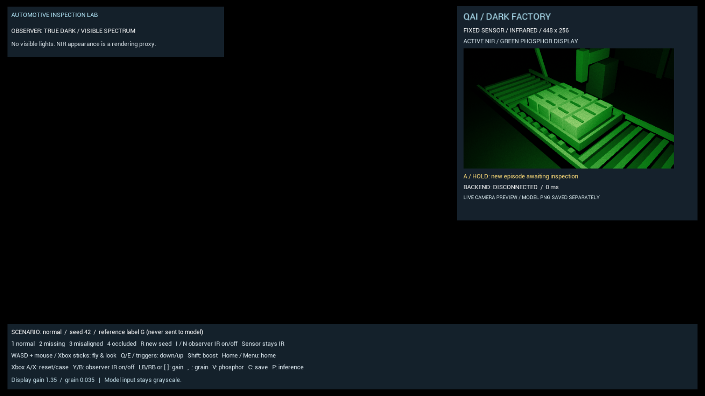
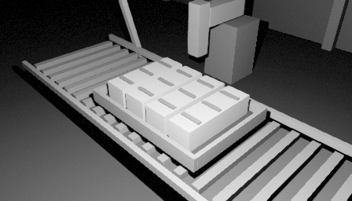
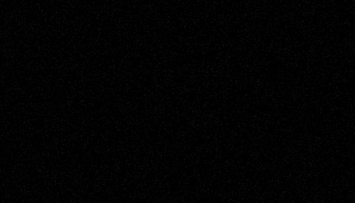
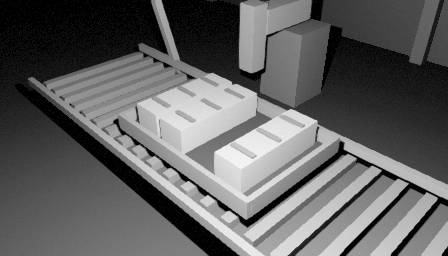
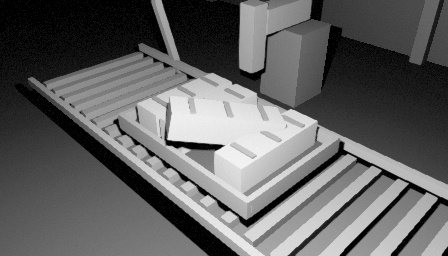
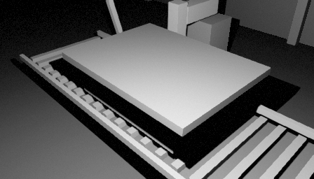
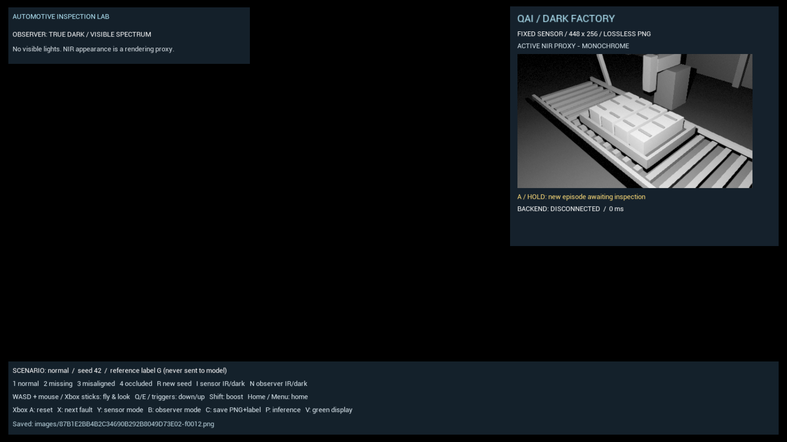

# Night vision experiment

An automated factory can operate without human work lighting. Its cameras still need a source of useful radiation. The starter uses an active-NIR rendering proxy for inspection and an intensifier-style green presentation for the observer and sensor preview. The normal visible observer now has dim roof-window light for navigation; complete darkness is an explicit calibration condition.

| Mode | Physical interpretation | Starter status |
| --- | --- | --- |
| Dim visible view | Low visible illumination entering from roof windows | Interactive observer mode; two visible-only light proxies |
| Zero-light calibration | Useful visible illumination is deliberately removed | Offline smoke/dataset condition; sensor darkness is an internal calibration control |
| Active near infrared | An NIR illuminator lights the scene for a camera sensitive to its wavelength | Rendering proxy used for the fixed sensor and assisted observer |
| Image intensification | Photocathode conversion, electron multiplication and visible phosphor output | Green display shader with grain, gain, vignette and optional halo approximations; no calibrated intensifier |
| Thermal LWIR | Detects emitted thermal radiation, depending on temperature and emissivity | Separate implemented temperature/heat-transfer proxy; see [thermal rendering](thermal_rendering.md) |

Green is a presentation palette, not infrared radiation. It cannot create missing scene information. See the cited [infrared research](infrared_research.md) for the differences between active NIR, image intensifiers and thermal imaging.

## Rendered green presentation

These are actual Unreal runtime views. The green treatment is applied to the observer and to the displayed sensor preview.


This earlier capture shows the explicit zero-light calibration condition with the independent sensor preview still available. The normal interactive visible view now uses dim roof-window illumination:



## Display shader and controls

The shared HLSL maps luminance through dark green, medium green and pale yellow-green shades. Gain feeds a soft highlight rolloff. Fine animated grain has a small read-noise-like floor and a signal-dependent component; its pattern updates at 24 Hz during interactive operation. An aspect-correct vignette gently darkens the edges. These are visual approximations, not calibrated photon statistics, electron optics or lens measurements.

The default shader uses one texture sample per pixel. The optional quality variant adds four nearby samples for a thresholded halo, for five samples total. The default compiles those extra samples out. Palette, gain, vignette and procedural grain run in the same GPU display pass; a 24 Hz grain pattern does not limit the shader's draw rate. Launch the quality variant with:

```powershell
.\unreal\Scripts\run.ps1 -NightVisionQuality
```

The [implementation comparison](night_vision_implementations.md) records the source patterns behind these choices, including pass count, texture samples and avoiding CPU readback for previews. It contains no measured speedup claim.

| Control | Action |
| --- | --- |
| `V` | Toggle green/monochrome presentation for both observer and sensor preview |
| `[` / `]`, Xbox LB / RB | Decrease/increase display gain by 0.1 |
| `,` / `.` | Decrease/increase display grain by 0.005 |
| `I` / `N`, Xbox B | Toggle the observer between assisted night vision and the dim visible view |
| Tab / Xbox Y | Cycle visible → NIR → thermal observer modes |
| `T` | Toggle thermal/NIR observer mode |
| `C` | Queue a fresh asynchronous sensor capture and save PNG + metadata |

Monochrome mode retains display gain, grain and vignette, plus halo in quality mode. The fixed sensor stays in active-IR mode during the interactive demo. Observer modality controls affect only the observer. Sensor-off images are available through internal offline calibration, not an interactive sensor toggle. Use saved PNGs to examine the actual model input.

Defaults are stored in the `[DarkFactory.NightVision]` section of [DefaultGame.ini](../unreal/Config/DefaultGame.ini). Runtime values are clamped to these ranges:

| Setting | Default | Allowed range |
| --- | --- | --- |
| Gain | 1.35 | 0.25–3.0 |
| Grain | 0.035 | 0–0.12 |
| Vignette | 0.30 | 0–0.80 |
| Halo | 0.12 | 0–0.50 |
| Seed | 17 | 0–10000 |
| Quality | False | False / True; halo samples enabled only when True |

Executable overrides use `-DFNVGain=`, `-DFNVGrain=`, `-DFNVVignette=`, `-DFNVHalo=` and `-DFNVSeed=`. For example, `-DFNVGrain=0` disables display grain. `-DFNVQuality` selects the quality variant; the launcher exposes this as `-NightVisionQuality`. Automation freezes the grain frame except when the night-vision smoke sequence deliberately changes it for comparison.

## Dim visible view and zero-light calibration

The visible observer receives light from two downward-facing roof-window rect-light proxies. Each starts at **80 lumens**, with a 220 × 180 cm source and a position 520 cm above the floor. This is an authored visual setting, not a measured window, daylight or camera response. Tune both lights together:

```powershell
.\unreal\Scripts\run.ps1 -NoInference -RoofLightLumens 80
```

Use `-RoofLightLumens 0` for a zero-light comparison. `-Smoke`, `-NightVisionSmoke` and offline dataset runs explicitly set roof illumination to zero, preserving their dark-observer and sensor-off conditions. Thermal smoke switches off roof and NIR lights together for its lighting-independence comparison. Existing dark example images below show calibration, not the current visible-view default.

The rect lights affect visible view channel 0; active NIR uses view channel 1. Roof lights have no indirect contribution, volumetric scattering or shadows. They approximate soft visible fill rather than window shafts or physically solved daylight. Their lumen setting is not directly comparable to the existing NIR illuminator's unitless Unreal intensity.

For six native viewport captures from one pose, run:

```powershell
.\unreal\Scripts\run.ps1 -ModalityScreenshots -NoInference -Output artifacts\modalities
```

This records visible roof lighting, green and monochrome NIR, and three thermal palettes. `modalities.json` records settings and the comparison of sensor PNGs with roof lighting off/on. The sequence leaves the simulator open with inference paused. This command describes the capture workflow; a new run's outcome must be read from its report.

## Canonical shader sources and regeneration

The editable sources are:

- [NightVisionCommon.ush](../unreal/Shaders/NightVisionCommon.ush): luminance, gain/rolloff, grain, vignette and palette.
- [NightVisionPostProcess.usf](../unreal/Shaders/NightVisionPostProcess.usf): observer scene sampling and bright-neighbor halo.
- [NightVisionSensorUI.usf](../unreal/Shaders/NightVisionSensorUI.usf): sensor-preview texture sampling and halo.

[setup_content.py](../unreal/Scripts/setup_content.py) embeds the common source and each entry point into generated Unreal Custom material expressions. It rebuilds `/Game/Materials/M_PP_NightVision` as an after-tonemapping post-process material and `/Game/Materials/M_UI_NightVision` as a UI material, plus a `Quality`-suffixed version of each. `DF_NV_HALO=0` produces the one-sample default and `DF_NV_HALO=1` enables the quality halo. All variants use the same display parameters. The observer shader samples PostProcessInput0; the UI shader samples the sensor render target directly.

After editing HLSL, regenerate the materials from the repository root:

```powershell
.\unreal\Scripts\build.ps1 -SkipBuild
```

This skips C++ compilation but runs content generation. The four generated materials are rebuilt in place, recompiled and saved with source-hash metadata. Edit the canonical HLSL rather than hand-editing generated material nodes, because regeneration replaces those nodes. Relaunch the demo to inspect the result. C++ changes still require the normal build.

## Keep presentation separate from inspection

The display parameters do not modify the fixed **448 × 256 lossless grayscale RGB PNGs** used for inference and dataset capture. The observer post-process operates on its own view. The HUD's UI material reads `SensorTarget` directly on the GPU, before CPU grayscale augmentation and PNG encoding. Consequently, the preview is not an exact copy of the model input: its display grain and palette differ, and it does not include CPU sensor gain/noise augmentation.

The sensor render target refreshes at **15 Hz** by default, independently of the display grain's 24 Hz pattern. Set `PreviewHz` in `[DarkFactory.Sensor]` in [DefaultGame.ini](../unreal/Config/DefaultGame.ini), or pass `-DFPreviewHz=` to the Unreal executable; values are clamped to 1–30 Hz. The launch script does not expose a separate preview-rate parameter.

Browsing with inference disabled and no save requested requires no CPU image readback. When a live model request or save needs pixels, `FRHIGPUTextureReadback` queues a transfer. The game thread polls readiness without waiting, with at most one readback/encoding job in flight. A CPU worker applies the same deterministic grayscale sensor augmentation and PNG encoding used by the offline path. Results from an obsolete scene epoch are discarded. Pressing `C` queues a fresh capture rather than reusing a previously saved PNG.

Offline datasets and calibration use synchronous readback and encoding to preserve deterministic capture ordering. Capture exposure, sensor gain and sensor noise affect model pixels and are recorded in dataset metadata. Changes to those settings require matching capture, training and inference. Green/monochrome presentation, display gain, display grain, halo and vignette remain separate and require no adapter or dataset changes.

The [night-vision QA workflow](night_vision_qa.md) renders fixed comparison views, checks display materials, examines palette and temporal grain changes, compares model PNG bytes across display changes, and checks the dark-observer/active-sensor case. Run `run.ps1 -NightVisionSmoke` for those display checks. `run.ps1 -ReadbackSmoke` checks GPU browsing without CPU readback, synchronous/asynchronous PNG byte parity, stale-epoch rejection and observer/sensor independence. These are rendering and data-path checks; neither establishes physical infrared accuracy, model accuracy or a sustained performance result.

## Rendering approach and limitations

The active-NIR experiment uses a separate Unreal view-lighting channel from the dim visible roof lights. NIR preserves its geometric shadows and occlusion, while the roof-light contribution is restricted to the visible view. Dynamic indirect lighting is disabled so these sources do not leak through global illumination into the other view. Runtime meshes use opaque materials.

This is a geometric prototype, not a spectral renderer. Unreal's ordinary shading evaluates material parameters chosen for visible rendering. Real NIR reflectance, lens transmission, wavelength, illuminator power and sensor quantum efficiency are not calibrated here. A material that looks black in RGB can look bright in NIR, and vice versa.

Epic distinguishes surface lighting channels from view-lighting selection. Its documented surface-lighting implementation works with dynamic lighting and opaque surfaces, with limitations for translucent and masked materials. Validate purchased glass, decals and special materials separately. See [Epic: Lighting Channels](https://dev.epicgames.com/documentation/en-us/unreal-engine/using-lighting-channels-in-unreal-engine).

Exposure-dependent motion blur, rolling shutter, measured fixed-pattern noise, physical full-well saturation, lens distortion and wavelength-dependent response remain future sensor-model work. Display highlight compression is not a physical saturation model. Avoid changing image resolution, crop or aspect ratio without rebuilding the data and checking the IQ9 vision configuration.

## Grayscale sensor examples

These are actual 448 × 256 Unreal sensor captures with seed 42. No model prediction is shown; captions identify the simulator's constructed case. The grayscale images illustrate the model-input path independently of the green display.

| Active infrared proxy: normal | Offline calibration: illumination excluded from sensor view |
| --- | --- |
|  |  |

| Missing module | Misaligned module | Obscured tray |
| --- | --- | --- |
|  |  |  |

Earlier zero-light calibration with a grayscale sensor preview:



## Next sensor experiments

Freeze the scene and sensor pose, then compare active-IR and illuminator-off captures in offline calibration. Move the spectator and vary display controls while checking that fixed sensor framing and pixels remain stable. Audit saved PNGs for grayscale pixels, absence of overlays and visible fault geometry.

Randomize capture nuisances independently of anomaly class, including glare, low signal and occlusion as held-out challenges. Keep manual exposure and matching preprocessing across capture and inference. Later compare a real NIR camera against the simulated materials and defect visibility; primitive-scene results do not establish real-camera performance.

