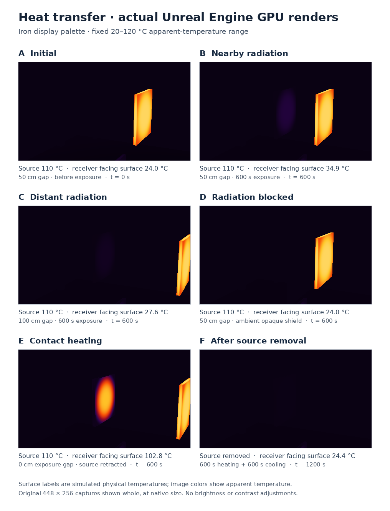

# Heat transfer between components

The demo now runs a small thermal network: hot components can warm facing surfaces through radiation and exchange heat through approximate contacts. State evolves when the selected simulation time advances. The CPU solves the network; the GPU renders the resulting surface fields. This is an illustrative model, not a calibrated factory thermal simulation. Research and source review: 2026-09-11.

## Using the demo

Heat transfer is **on by default**, starting at 15 seconds of selected elapsed time.

- **U** advances another 15 simulated seconds, up to 1,800 seconds, then cycles to zero. Wall-clock time does not advance the thermal state.
- **O** or **Xbox right-stick click** toggles heat transfer. Off uses the earlier independent cooling approximation. Re-enabling resets temperatures and replays the currently selected time with the current geometry; it does not resume the old network.
- **H** changes the thermal case and resets elapsed time to 15 seconds. The nearby-heat-transfer case places a maintained 110 °C source opposite an initially 24 °C receiver, with a 50 cm surface gap. Entering that case automatically frames the source and receiver in the observer view; leaving it returns the observer to its home view.
- **T** selects thermal observer mode; **K** changes its palette; **F9** saves the fixed thermal sensor image and metadata. **J** toggles spatial presentation; disabling it shows uniform source temperatures while the network remains available to advance with U.

Translations and rotations preserve stored node temperatures. Moving a donor away therefore does not erase heat already stored in the receiver's face. Future U advances rebuild exchange links from the new geometry and cool or heat that retained state. Component resizing is treated as an authored reset: capacities are rebuilt and the selected elapsed time is replayed. This samples geometry when time is advanced; it does not integrate a continuously moving assembly's full trajectory.

## Bulk and six-face network

[DarkFactoryHeatExchange.cpp](../unreal/Source/DarkFactory/DarkFactoryHeatExchange.cpp) represents every registered component with one bulk node and six skin nodes, plus a shared fixed 24 °C ambient node. Geometry comes from the scaled mesh-local bounding box. Hidden components keep their stored temperatures but have no active links while hidden.

Each node has a positive heat capacity. The component capacity is `volume × volumetricCapacity`. The skin receives the smaller of 40% of that total or `surfaceArea × skinThickness × volumetricCapacity`; its six faces share this allocation according to their areas. The bulk receives the remainder. This partitions mass rather than assigning the whole body's capacity to every face. Reduced thermal networks have an established engineering basis, but need measurements and calibration for accuracy. [NASA's nodal-model report](https://ntrs.nasa.gov/citations/20000025404) describes both the method and experimental calibration.

| Setting | Implemented value | Meaning |
| --- | ---: | --- |
| Volumetric heat capacity | 1,500,000 J/(m³ K) | Common effective material |
| Skin thickness | 0.0001 m | Low-capacity surface layer |
| Bulk-to-face conductivity | 0.2 W/(m K) | Insulation-like proxy |
| Air heat-transfer coefficient | 5 W/(m² K) | Uniform ambient convection |
| Contact conductance coefficient | 100 W/(m² K) | Approximate contacting interfaces |
| Contact tolerance | 0.75 cm | Geometric classification tolerance |
| Radiation cutoff | 150 cm | Maximum face-centre separation |

These values are authored inputs, not properties inferred from Unreal RGB materials. In particular, the low conductivity retains visible surface gradients and should not be presented as bare-metal or battery construction data. All components currently use the same capacity and conductivity model. Hollow structures, heterogeneous cells, glue cure chemistry, internal airflow and real interface resistance need their own parameters or models.

Bulk-to-face conductance is `k A / distance`, using half the box thickness and a minimum 1 mm distance. Powered heater nodes hold their assigned temperature and act as reservoirs. In the heater-fault case the failed strip starts at ambient and becomes passive, so neighboring parts can warm it. The maintained source and cold blocker in the transfer verification fixture are explicit reservoirs, not finite passive bodies.

## Radiation and obstruction

For black surfaces, reciprocal exchange follows:

```text
Qij = sigma Aexchange_ij (Ti_K^4 - Tj_K^4)
Aexchange_ij = Ai Fij = Aj Fji
```

`Fij` is the fraction leaving i that reaches j. Reciprocity gives equal and opposite exchange and zero net transfer at equal temperature. [MIT derives this relation](https://web.mit.edu/16.unified/www/FALL/thermodynamics/notes/node137.html). [NIST gives sigma](https://physics.nist.gov/cuu/pdf/wallet_2022.pdf) as approximately `5.670374419e-8 W/(m² K⁴)`. Heating uses total-spectrum radiation; the camera separately computes its 8–14 µm apparent-temperature response.

The implementation considers outward-facing patch pairs within 150 cm. A centre-to-centre segment test against visible oriented mesh boxes rejects obstruction, including extra opaque covers. Signed scale is accounted for in the outward normals. The approximate exchange area is:

```text
Aproxy = Ai Aj cos(theta_i) cos(theta_j)
         / (pi distance_m² + max(Ai, Aj))
```

The denominator bounds close-range exchange. This is a view-area proxy, not an exact integrated view factor. Each pair is then scaled symmetrically so its two endpoints respect their remaining surface-area budgets. Contact area is removed first. The algorithm preserves reciprocal links instead of independently normalizing each direction.

The radiation coefficient sent to the solver is `eps_i eps_j Aproxy`: **direct absorbed exchange only**. Reflected bounces are omitted. Full diffuse-gray radiosity couples emitted and reflected irradiation throughout an enclosure, as explained in [COMSOL's radiosity documentation](https://doc.comsol.com/6.3/doc/com.comsol.help.heat/heat_ug_theory.07.051.html). Remaining exposure exchanges with the ambient reservoir. This conservative network does not reproduce every reflected energy path.

One segment makes visibility all-or-nothing for a whole face pair; thin partial covers, openings and concave geometry are approximated by boxes. The 150 cm cutoff omits distant mutual exchange and is a performance assumption, not a physical boundary. A blocker can itself exchange heat, but heat does not jump through it directly. More detailed patch integration or ray sampling would improve partial visibility. [COMSOL's view-factor discussion](https://doc.comsol.com/6.3/doc/com.comsol.help.heat/heat_ug_theory.07.053.html) explains visible-surface integration and normal projection.

## Contacts and thermal scale

A contact candidate requires opposing nearly parallel normals, absolute plane separation no more than 0.75 cm, overlapping projected footprints, and no intervening blocker on the test segment. The accepted area is bounded by both faces and scaled to avoid exceeding either face's contact budget. Its conductance is `h_contact Acontact`. Non-contacting pairs may exchange radiation; there is no separate gas-gap conduction model.

The tolerance accepts small gaps or penetrations in the primitive scene; it does not prove microscopic contact. Rotated footprints use projected bounding rectangles, which can overestimate actual overlap. Final assets need authored contacts or tighter geometric tests. Real contact depends on pressure, roughness, material and any interstitial fluid, as distinguished in [COMSOL's contact theory](https://doc.comsol.com/6.3/doc/com.comsol.help.heat/heat_ug_theory.07.090.html).

For scale, a 95 °C black surface facing 24 °C surroundings has calculated net flux **599.53 W/m²**. A 0.01 m² patch with view factor 0.1 exchanges approximately 0.600 W; with both emissivities 0.9, the direct-only proxy gives 0.486 W. A 100 J/K receiving node initially warms about 0.291 °C/min before losses or source changes. In contrast, 0.001 m² of contact at the configured conductance transfers 7.1 W across 71 K. Nearby does not necessarily mean strong radiation, and low-capacity skin can respond much faster than the bulk.

## Integration, GPU presentation and evidence

[DarkFactoryHeatSolver.cpp](../unreal/Source/DarkFactory/DarkFactoryHeatSolver.cpp) computes each edge flux once and applies opposite joules to its endpoints. Every node update uses the same previous substep. The adaptive step is at most `0.2 × min(Ci / sumGi)` and one second; the nonlinear radiative conductance uses the exact factorization of `Ti_K⁴ - Tj_K⁴`. There is a 200,000-step limit. Invalid inputs or arithmetic reject the whole requested advance without partially changing node temperatures.

Fixed nodes maintain their temperature. `supplied_energy_j` records their net energy input, including ambient removal, and `energy_residual_j` compares passive-node energy change with that supply. Network cooling replaces the old exponential attenuation when transfer is enabled, avoiding duplicate losses.

The [thermal shader](../unreal/Shaders/ThermalPostProcess.usf) selects the visible local box face and blends the earlier edge/centre field toward that face's node temperature using a smooth centred patch. This **convex blend** stays between its endpoints; an additive negative correction could otherwise manufacture temperatures below all simulated nodes. Face patches are centred approximations, not resolved donor footprints. Heat modifies surface temperature before emissivity/reflected-ambient radiometry and observer palette mapping.

The GPU profile texture is now **256 × 12 RGBA32F = 48 KiB**. It stores affine coordinates, field parameters, six face deltas and the radiometry fit range. A visible transfer pixel loads seven profile texels, selects one face and evaluates the existing local field, patch blend and quadratic apparent-temperature fit. There is no per-pixel heat solver, Planck integration or CPU image processing for heat exchange. CPU pair construction runs when simulated time advances or the network resets; changed profiles/transforms upload through `UpdateTextureRegions`. Scene rendering and requested PNG capture still have their normal costs.

Snapshots use `dark-factory-thermal-sensor-v3`, retain fixed 448 × 256 grayscale apparent-temperature encoding over 20–120 °C, and record elapsed time, model coefficients, network counts, energy accounting, bulk/face values and geometry. Palettes remain display-only; this thermal distribution requires its own evaluated adapter strategy and does not alter NIR inputs.

The [standalone numerical checks](../scripts/tests/thermal_heat_solver_check.cpp) passed conservation, equilibrium, unequal-capacity convergence, radiation-reference, reservoir-sign, deterministic replay and transactional-failure checks, including AddressSanitizer and UndefinedBehaviorSanitizer. These establish solver behavior, not physical calibration. The completed GPU run and scoped CPU timing observations are recorded below.


## Completed GPU validation

The final opaque-alpha `artifacts/thermal-transfer-v2` run passed **all 138 transfer checks**, plus the independent **42 thermal-rendering** and **55 spatial-field** checks with transfer disabled. The standalone solver passed all **12 numerical check groups**. No acceptance thresholds were relaxed. The final captures retain their actual RGB values and were inspected visually.



The figure uses complete, unmodified 448 × 256 GPU iron-palette captures at native resolution. Its labels are simulated physical face temperatures; the colors represent the separate 20–120 °C apparent-temperature display window. The nearby receiver's subtle purple appearance is preserved. Contact and 2 cm-gap exposures retract the donor before inspection without advancing time, so the camera can see the stored heat on the formerly covered face.

| Controlled state | Receiver face toward source, physical °C | Observation |
| --- | ---: | --- |
| Initial, 0 seconds | 24.000 | Ambient receiver |
| 50 cm gap, 600 seconds | 34.885 | Facing surface warms; opposite face is 24.546 °C |
| 100 cm gap, 600 seconds | 27.584 | Weaker radiation at greater separation |
| Opaque ambient blocker, 600 seconds | 24.000 | Direct heating blocked |
| Contact, 600 seconds | 102.844 | Strong contact heating |
| 2 cm gap, 600 seconds | 57.778 | Less heating than contact |
| Donor relocated immediately after the near exposure | 34.885 | Stored temperatures persist |
| Donor removed, a further 600 seconds | 24.438 | Receiver surface cools toward ambient |

The near and immediately relocated captures have **zero RGB difference across all 6,929 common receiver pixels**. After contact, the hottest 20% of common receiver pixels exceed the gap case by 106.246 counts. The blocked comparison uses 4,322 common receiver pixels because the opaque shield hides part of the receiver; unrelated background and shield pixels are excluded by visible stencil ID. Back-facing projected face boxes are not treated as visible samples.

Every state passed the reservoir-aware energy check: `abs(residual_j) <= max(0.001, abs(supplied_energy_j) × 1e-8)`. The largest absolute residual was **4.253 × 10⁻⁶ J**; the largest residual relative to absolute supplied energy was **5.111 × 10⁻¹²**. The authored fixed source and ambient reservoirs are included in this accounting.

Four measured offline 600-second advances took **17.70–18.53 ms CPU**, with a mean of **18.20 ms**. The network had 568 nodes and used 2,393 integration steps per 600-second interval. These observations cover CPU heat-advance work, not total frame duration, GPU rendering, sustained live performance or FPS. Contact, gap and relocated-state final timings are excluded because their last measured operation was a zero-duration link rebuild after moving the donor.

Portable counts, unchanged thresholds, temperatures, image comparisons, energy results, timing scope and source hashes are retained in [thermal_transfer_validation.json](thermal_transfer_validation.json). Replay the captures and independent checks from the repository root:

```powershell
.\unreal\Scripts\run.ps1 -ThermalSmoke -Output artifacts\thermal-transfer-v2
python scripts/verify_thermal_transfer.py --directory artifacts/thermal-transfer-v2 --output artifacts/thermal-transfer-v2/transfer_qa.json
python scripts/verify_thermal.py --directory artifacts/thermal-transfer-v2 --output artifacts/thermal-transfer-v2/qa.json
python scripts/verify_thermal_fields.py --directory artifacts/thermal-transfer-v2 --output artifacts/thermal-transfer-v2/field_qa.json
python scripts/render_thermal_transfer_comparison.py --directory artifacts/thermal-transfer-v2 --output docs/media/thermal-transfer-comparison.png
```

The verifier and figure script require Pillow. The existing WSL interpreter documented in [thermal_qa.md](thermal_qa.md) can run both without installing dependencies. These checks establish the implemented transfer behavior and preserve the earlier thermal/NIR guards; they do not establish factory-process accuracy or a trained thermal adapter.
