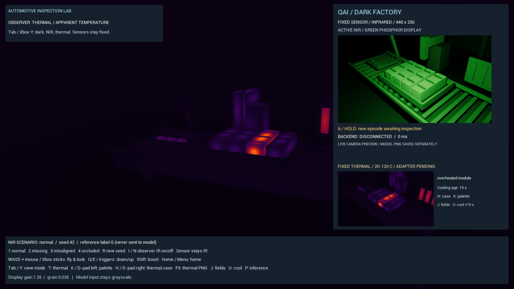

# Thermal rendering and fixed sensor

The demo has independent NIR and thermal sensors. The observer can switch between dim visible roof lighting, NIR and thermal views, while each sensor keeps its own modality. Thermal snapshots use a separate contract; a thermal inspection prompt, training dataset and adapter are pending.

In the procedural reference scene, the thermal renderer couples **body and surface temperatures between nearby parts**. Contact conducts heat; facing surfaces exchange thermal radiation, with distance and opaque blockers reducing that exchange. Warm surfaces retain heat after the source moves. A small CPU thermal network supplies temperatures to GPU surface shading. These are coarse, illustrative material and geometry approximations, not a calibrated thermal camera. [Heat-transfer implementation](thermal_heat_transfer.md) describes the equations and limits. [Physical basis and field equations](thermal_spatial_fields.md) explains the assumptions; [implementation research](thermal_rendering_research.md) compares existing renderers.

## Try the views and cases

```powershell
.\unreal\Scripts\build.ps1
.\unreal\Scripts\run.ps1 -NoInference
```

| Control | Action |
| --- | --- |
| Tab / Xbox Y | Cycle observer: dim visible, NIR, thermal, bright factory |
| T | Toggle thermal / NIR |
| I / N / Xbox B | Toggle NIR / dim visible view; return from thermal to NIR |
| K / Xbox D-pad left | Cycle thermal white-hot, black-hot and iron palettes |
| H / Xbox D-pad right | Cycle thermal cases and reset cooling age to 15 seconds |
| J / Xbox D-pad up | Compare spatial fields with the original uniform-temperature rendering |
| U / Xbox D-pad down | Advance selected simulated time by 15 seconds; wrap to zero after 1800 |
| O / Xbox right-stick click | Toggle heat exchange / legacy isolated cooling; switching on reinitializes the network at the selected age |
| F9 | Save raw thermal PNG and frozen capture metadata |
| C / P | Capture NIR / toggle NIR inference |

In the procedural reference scene, heat exchange is **enabled by default**. Simulated age is a **selected, frozen simulation state** shown in the HUD, not elapsed wall-clock time. This keeps captures deterministic. Uniform comparison reproduces the original assigned temperatures without spatial cooling. The observer defaults to the iron color palette; white-hot and black-hot remain selectable. The welding sensor panel displays color and white-hot monochrome together using the same camera render. Palette changes are display-only. NIR display controls remain separate.

Thermal views include a horizontal **apparent-temperature scale**. The fixed color and monochrome previews retain iron and white-hot scales respectively; the observer's scale follows its selected white-hot, black-hot or iron palette when you press K / Xbox D-pad left. Temperature always increases from left to right, including in black-hot mode. Labels show the configured minimum, range midpoint and maximum, currently 20, 70 and 120 C. These are display-range ticks, not minimum/mean/maximum measurements of the current image. Apparent temperatures below or above the range use the corresponding endpoint color, so a saturated color does not distinguish temperatures beyond that limit. The procedural thermal preview also has a matching scale.


| Thermal case | Assigned source state before surface cooling |
| --- | --- |
| Normal | Modules 45 °C, powered heater strips 65 °C, glue 58 °C |
| Overheated module | One module and its ribs 95 °C |
| Heater fault | Centre heater strip at ambient 24 °C |
| Glue gap | Centre warm-glue segment absent, exposing the cooler plate |
| Nearby heat transfer | 110 °C source and initially ambient receiver above the line (Z = 350 cm); observer frames the fixture, leaving the case returns home |

The camera sees the visible surface. An opaque cover hides the hot part; the shader does not reveal its internal core. The automated cover case is separate from the interactive cases.

## GPU surface fields

[DarkFactoryThermalRig.cpp](../unreal/Source/DarkFactory/DarkFactoryThermalRig.cpp) registers up to 255 mesh components, each with its own stencil ID, local bounds, temperature and emissivity. Unregistered surfaces use ambient temperature. The current primitive meshes use bounding-box dimensions as an approximation of physical volume and surface area.

With exchange enabled, each component has a bulk node and six surface nodes. Finite-capacity nodes exchange equal/opposite energy through internal conduction, geometrically detected contact, direct radiation and an ambient reservoir. Working heater strips are thermostated; a faulted strip is passive. The GPU blends the body field toward the visible face temperature with a bounded local patch. Translation/rotation preserves stored heat; resizing resets and reintegrates the network with new capacities. With exchange disabled, the original `V/A` exponential cooling proxy remains available for comparison.

The CPU computes apparent temperatures at the minimum, midpoint and maximum of the bounded surface field using the flat 8–14 µm Planck band and emissivity/reflected-ambient mixing. The GPU uses a quadratic interpolation between those three radiometric samples. This avoids spectral integration in every pixel. Exchange fields are versioned as `object-local-heat-transfer-v1` (legacy comparison: `object-local-cooling-v1`); [the spatial-field guide](thermal_spatial_fields.md) gives the equations and sampled interpolation-error measurements.

A **256 × 22 float RGBA LUT (88 KiB)** carries radiometric samples, three world-to-normalized-local affine rows, field parameters, six face patches and temperature-fit bounds. Row 12 stores the optional tool hotspot world-space centre/inverse radius squared. Row 13 stores tool-tip temperature, imported-core mode, dominant local axis and normalized core offset; its existing spare channels select the casting field without enlarging the texture. Rows 14–21 store four car-weld patch pairs with the same position/radius layout and a surface temperature. Texture regions update when profiles or transforms change without recreating the texture. Temperature changes share one upload with moving mesh transforms; local hotspots follow their mesh. Procedural scale changes reset thermal capacities. [Car-weld heat](welding_body_heat.md) describes the imported surface-only fields.

[ThermalPostProcess.usf](../unreal/Shaders/ThermalPostProcess.usf) uses point-sampled SceneDepth, CustomDepth and CustomStencil, with Unreal's depth-reconstructed WorldPosition. The depth comparison rejects heat behind opaque geometry. The spatial path contains twelve source-level LUT loads, including the shared core-shape/tool-temperature row, the tool-hotspot position and four weld-patch enables. Exchange adds one face read. The tool reuses the already-loaded row 13 temperature, while each active weld patch adds one temperature read. Current imported tools therefore use twelve reads, and car panels with one/two spots use thirteen/fourteen, with exchange disabled. These are source counts, not measured GPU transactions. Tool heat uses a smooth radial blend; weld patches max-combine against the original surface, so overlap cannot cool it. Zero-radius rows contribute nothing and uniform comparison retains the body-only path. No visible-light brightness drives the temperature. Imported warm robot castings use a shifted mesh-local core field, while near-ambient and disconnected parts keep uniform base profiles; [the imported-field guide](imported_thermal_fields.md) describes that authored model. Imported bulk exchange remains disabled.

This compact scene is near the world origin. Very large worlds or origin rebasing should subtract a shared cell origin before converting world coordinates to float. Bounding-box fields are suitable for these primitives; irregular purchased meshes need authored heat fields, meaningful part subdivision or a physical solver.

## Fixed sensor and snapshots

The thermal camera starts at the NIR camera's pose/FOV and then operates independently at **448 × 256**, default **10 Hz**. Its linear BGRA8 target has gamma 1. Lighting, fog, bloom, motion blur and anti-aliasing are disabled for this capture. Manual captures retain a view state (`bAlwaysPersistRenderingState=true`) so Unreal executes post-process materials.

Raw pixels always encode grayscale apparent temperature over **20–120 °C**:

```text
signal = clamp((apparent_temperature_c - 20) / 100, 0, 1)
apparent_temperature_c = 20 + 100 * pixel_value / 255
```

The reconstruction applies inside the unclipped range; endpoints may be saturated. The 0.392 °C quantization step is not measurement accuracy. Palettes, NIR grain and NIR augmentation never enter these thermal pixels.

F9 writes PNG + JSON to `unreal/Saved/Thermal/`. The new contract is **dark-factory-thermal-sensor-v3**, recording exchange settings, energy ledger, six face temperature offsets, field model and simulated age in addition to source/core/edge temperatures, emissivity, powered state, dimensions/local bounds, part/camera transforms, episode identity and capture-submission time. Metadata is frozen with a fresh capture. Scene resets reject stale pending images and previews; continuous motion remains represented by capture-time transforms. These exports are not a frozen training dataset: `adapter_ready=false`, `training_manifest=false`. Do not mix them with the NIR adapter or the older uniform thermal samples.

## Cost, generation and validation

The HUD samples the GPU render target directly through [ThermalSensorUI.usf](../unreal/Shaders/ThermalSensorUI.usf), using one image sample for its palette. Scale bars reuse that same material and palette code with a transient linear 256 x 1 grayscale ramp: a single 1 KiB initialization upload, three fixed-palette material instances, and narrow HUD draws. Their labels read the renderer's current range, and their display path matches the previews. The bars do not modify the thermal LUT, raw capture, saved PNG, or NIR input and require no sensor readback. An explicit export uses one asynchronous readback/encoding job at a time. Offline smoke references read back synchronously. No CPU image processing or per-frame image upload is required for live thermal previews.

The additional sensor capture, CustomDepth geometry draws, per-pixel LUT reads and occasional 88 KiB profile uploads have a cost. Sustained GPU timings and final-scene FPS have not been benchmarked. Adjust `[DarkFactory.Thermal] CaptureHz` in [DefaultGame.ini](../unreal/Config/DefaultGame.ini), or pass `-DFThermalHz=` (1–30) to Unreal.

Rebuild generated materials after shader edits:

```powershell
.\unreal\Scripts\build.ps1 -SkipBuild
.\unreal\Scripts\run.ps1 -ThermalSmoke -Output artifacts\thermal-transfer-v2
python scripts/verify_thermal.py --directory artifacts/thermal-transfer-v2 --output artifacts/thermal-transfer-v2/qa.json
python scripts/verify_thermal_fields.py --directory artifacts/thermal-transfer-v2 --output artifacts/thermal-transfer-v2/field_qa.json
python scripts/verify_thermal_transfer.py --directory artifacts/thermal-transfer-v2 --output artifacts/thermal-transfer-v2/transfer_qa.json
```

The image verifiers require Pillow. Earlier GPU renders before the tool/car-weld hotspot extensions passed **138 heat-transfer checks, 42 existing thermal checks and 55 spatial-field checks**, including moving/rotated parts, same-surface gradients, thinner-part cooling, unchanged powered heaters, lighting independence, occlusion, NIR invariance and async snapshot parity. [Thermal QA](thermal_qa.md) and [heat-transfer evidence](thermal_heat_transfer.md) record the measurements. Debug ID masks exist only in offline field QA and are never sensor exports or model input.

Remaining physical limitations include detailed within-face conduction, directional reflections, spectral material response, detector/lens effects and calibration. The heat coefficients, box geometry and edge profiles are demonstrative parameters rather than measured material properties. CPU integration occurs on selected time advances; stationary views do not continuously run the network.


