# Physics-aware agentic Edge AI for robotics: Simulated dark factory

**Author:** [Eivind Holt](https://www.linkedin.com/in/eivholt/), September 2026  

**Repository:** [github.com/eivholt/qai-physics-reasoning](https://github.com/eivholt/qai-automotive-dark-factory)  

**Target:** [Qualcomm Dragonwing IQ-9075 EVK / QCS9075 / Hexagon v73](https://www.qualcomm.com/developer/hardware/qualcomm-iq-9075-evaluation-kit-evk). Hardware generously sponsored by Qualcomm

**VLM Model:** [nvidia/Cosmos-Reason2-2B](https://huggingface.co/nvidia/Cosmos-Reason2-2B) Q4_0 GGUF running on device NPU

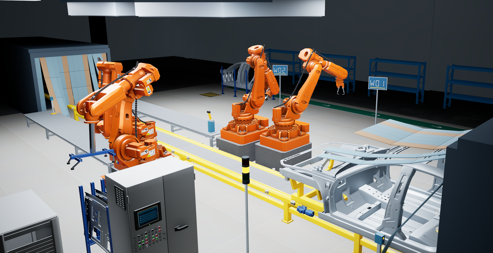

This tutorial simulates a fully automated factory with robotic arms controlled by an LLM-backed AI agent. The agent uses physics-aware VLM tools to determine current state and next steps. It all runs on a single Qualcomm Dragonwing IQ-9075 EVK, thanks to active concurrent model inference and some neat speed and accuracy tricks.

>[System One](https://docs.typesafe.ai/concepts/system-one) models, coined by TypeSafe AI, are a class of AI models built to make fast, structured decisions that software can use directly. Their model Jev went viral in late September 2026, but unfortunately it's not open weight and nowhere close to sized to run on Edge AI hardware. By coincidence this article and it's predecessor, [**Physics-aware Edge AI: Simulation powered by QualComm IQ9 EVK serving NVIDIA Cosmos Reason2**](https://dragonwingdocs.qualcomm.com/tutorial), from August 2026, utilize similar principles to speed up the inference processes: With the **VLM** Cosmos Reason 2, we fine-tune to make the model associate certain states with a single token, while utilizing the model's base knowledge. We also drop auto-regressive token decode by just picking the token of interest with the highest probability (logit). For the **LLM** in this project we prompt to only return one of the tokens of interest, and then again only look for the logit of interest with the highest probability. On constrained hardware this can mean a 10 - 20 x speed difference.


## Dark factory
[Dark factories, or lights-out manufacturing](https://en.wikipedia.org/wiki/Lights_out_(manufacturing)) denotes fully automated manufacturing, where lights and air-condition are redundant as a human workforce is not present. Think of the ending scenes of The Terminator (1984) where Sarah Connor fights for her life in an unattended, 24/7 assembly line. While literal dark factories do exist, this is more of a metaphor than about saving electricity bill.

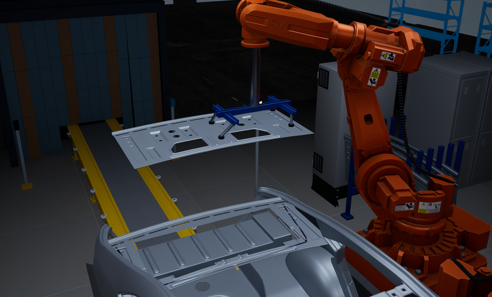

Often the production process still needs to keep humans in the loop due to visual quality assurance and other tasks that are hard to automate with traditional sensor technology. Keeping workers around is also often needed to handle unpredicted events, such as parts falling off, perhaps having to reset a rigid mechanical process. Advances in physics-aware visual language models (VLM) move visual computing beyond bounded object recognition, to being able to reason and answer questions about an image or short video clip. Additionally LLM-backed agentic AI allows for more dynamic process execution where policy and desired outcomes steer behavior, rather than rigid control flow instructions. This demo shows how all of this can be combined in a virtual factory, useful for smoking out problems before deployment in a real facility.

## Demo setup
A virtual vehicle assembly station was constructed by OpenAI Codex with GPT-6 Astra in Unreal Engine based on model assets purchased from 3D marketplace [TurboSquid](https://www.turbosquid.com/FullPreview/1370870). The assets of this demo is not included in the project repo due to licensing restrictions. As an alternative, coding assistants are becoming capable of [creating 3D assets using e.g. Blender](https://x.com/tomkrcha/status/2095756085890310311). Prepare for asset store inflation.


The simulation contains different virtual tools on robotic arms: inspection camera, sealant dispenser, vacuum placement tool and a spot welder.

A physical IQ9 EVK is connected to the computer running the simulation, serving a LLM, a VLM and an agentic harness. The agent controls the virtual arms, requesting inspection camera images, asking VLM to interpret the images, optionally waiting and recapturing and finally initializing the next assembly step.

This tutorial mostly keeps a high-level view of the different parts of the project, with some novel exceptions. Find details on subjects such as model deployment, fine-tuning and agentic harnesses in the tutorial section of the [Dragonwing developer documentation portal](https://dragonwingdocs.qualcomm.com/tutorial).

### Near-infrared (NIR) and thermal imaging simulation
The robot-mounted inspection camera switches between **near-infrared (NIR) and thermal imaging** according to the task. NIR checks whether the panel is present and correctly seated; thermal checks whether sealant contact areas and weld spots have cooled sufficiently. Both modalities produce lossless 448 × 256 grayscale images for Reason2, captured from three physical arm positions. The observer can independently switch visualization modes without changing these model inputs.

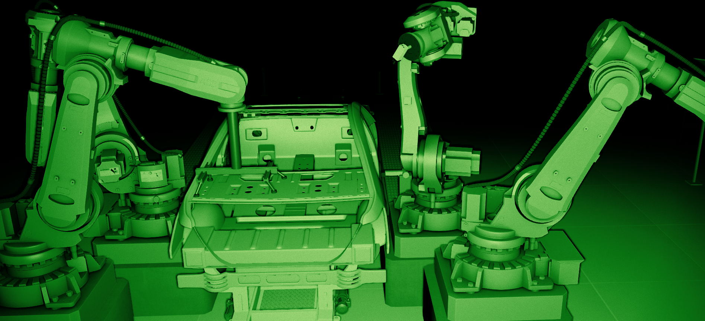

NIR simulates a camera observing reflected light from an active infrared illuminator. Separate lighting channels isolate the inspection camera’s source from visible factory lighting and the observer’s camera-mounted infrared beam. Unreal materials provide an illustrative NIR response rather than measured infrared reflectance. The inspection images remain grayscale, while the observer’s night-vision view adds green phosphor coloring, grain and lens effects through display-only post-processing.


Thermal imaging represents apparent surface temperature rather than reflected illumination. Assigned temperatures and emissivity feed GPU material shaders, which evaluate spatial temperature fields and an emission lookup table for the 8–14 µm thermal band. This rendering works independently of visible lighting and preserves opaque occlusion: the inspection camera sees heat on exposed surfaces, including heat conducted into the panel from sealant beneath it, rather than seeing through steel.

Temperatures vary across individual surfaces to avoid uniformly colored objects. Localized fields make robot motors warm with movement, welding tools and contact spots heat during operation, and residual warmth fade during cooling. A simplified contact-transfer model warms the panel surface above the sealant, giving the thermal inspection a visible signal to assess. These are illustrative surface-temperature simulations rather than calibrated predictions of industrial heating, adhesive cure or weld quality.

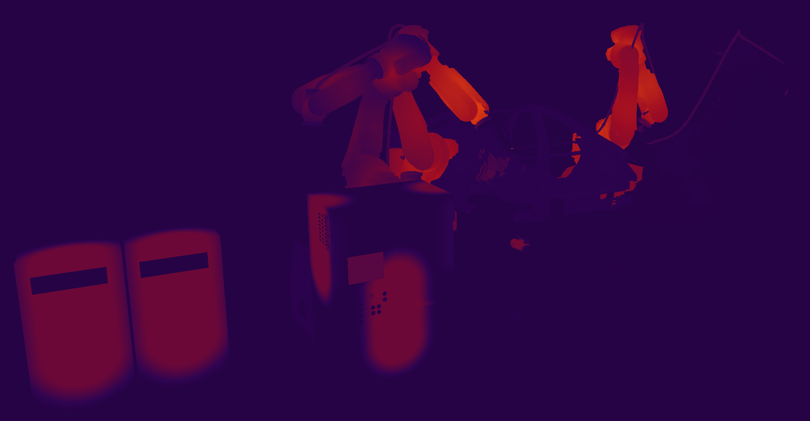
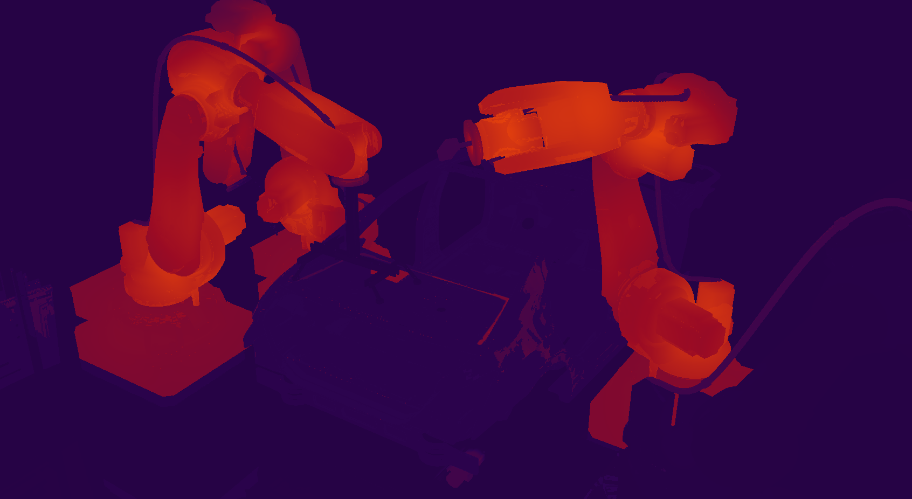
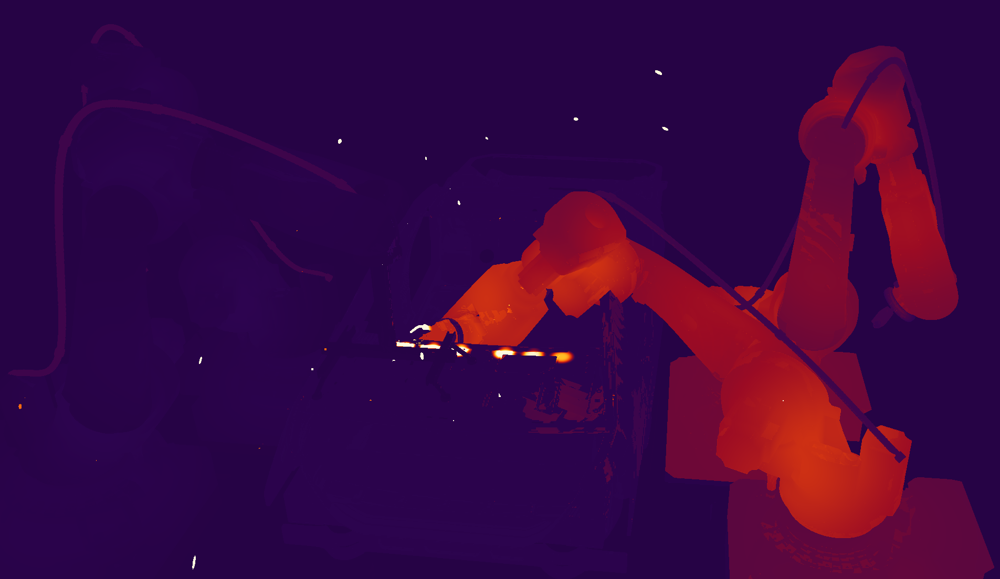

The inspection camera encodes thermal images as linear grayscale over a fixed **20–120 °C** window, keeping the mapping consistent for training and inference. The observer instead displays thermal imagery over **0–120 °C**, with selectable monochrome or multicolor palettes and a temperature scale. Surfaces above either window saturate at its upper limit. Observer palette choices, night-vision effects and HUD overlays never enter the images sent to Reason2.

## Physics-aware VLM
As detailed in previous tutorials, this demo uses [nvidia/Cosmos-Reason2-2B](https://huggingface.co/nvidia/Cosmos-Reason2-2B) for answering questions about visual inspection. The agent has tools that can answer whether panels are in place, if sealant has been sufficiently distributed, if the sealant has cooled after application (we imagine it creates an exothermic reaction untill settled), if spot welds have cooled and panels have not drifted (unlike in Tesla cars).

### VLM speed and accuracy optimizations

## Agent
The robotic processes seen in the demo are not hard-coded - rather a LLM-backed agentic harness is prompted to survey the scene and call the next actions. It has clearly described goals and tools it may elect to use to achieve it's goals. This quickly covers pretty complex traditional control-flow code, and can recover situations a developer might not have imagined.

### Harness
On the IQ9 EVK a small custom Python service is running. For speed, customization and simplicity no traditional agent framework is used, but PydanticAI, LangChain, OpenAI SDK, CrewAI etc. would probably be suitable. The LLM used by the agent is an unmodified [Ministral-3-3B-Instruct Q4_K_M](https://huggingface.co/unsloth/Ministral-3-3B-Instruct-2512-GGUF/blob/10ba09a6e10b59dc4fd074da98a34df9ea9775a2/Ministral-3-3B-Instruct-2512-Q4_K_M.gguf), hosted by llama.cpp. For efficiency and accuracy the agent has a concise list of available tools, identified by a single letter/token. A small loopback protocol adapter converts that token into the existing Unreal tool call.

| Code | Tool |
|---|---|
| A | Inspect panel presence |
| B | Apply sealant |
| C | Pick/place/hold the panel |
| D | Inspect sealant temperature |
| E | Weld the panel |
| F | Inspect panel seating |
| G | Inspect weld temperature |
| H | Release/retract holder |
| I | Send body forward |
| J / K / L | Wait 1 / 5 / 15 seconds |
| M | Hold for operator attention |

All 13 actions remain available on every turn. There is no state-dependent
action mask, recipe veto or fallback controller. These action letters are
separate from Reason2's G/R/A observation labels.

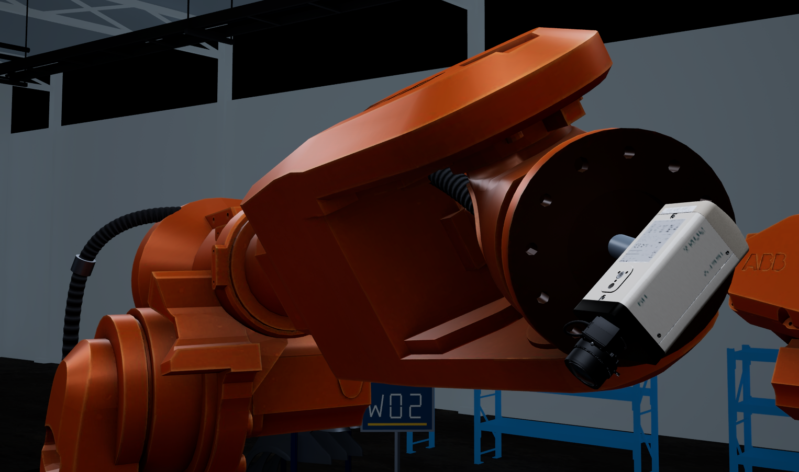

The adapter verifies that A–M are unique single tokens (IDs 1065–1077 for the
tested tokenizer), applies the native chat template, and requests one token
with temperature zero and the temperature sampler. It reads the unmasked,
pre-sampling top-128 log probabilities and requires the global highest-scoring
token to be one of the action codes. No grammar or logit bias forces a choice.
A non-action winner or malformed result returns an error; it does not silently
select the best remaining action. This is next-token `argmax` selection, not a
nearest-embedding search.

Only `top-128` scores are returned, not the full vocabulary. Omitted action
probabilities are reported as unknown, with bounds on total action probability
mass. We do not normalize a forced choice into artificial confidence, or apply
Reason2's trained vision thresholds to this untrained controller.

### Agent system prompt
Following is the system prompt to manage the assembly cell. Tool results are denoted by R=Red, G=Green, A=Amber, as in a traffic light. They have specific meaning in each tool. Tool result valid=false denotes inconclusive result.

Describing what you want for e.g. ChatGPT or Claude and have it write out the actual prompts is recommend d. LLMs typically talks better to other LLMs. Have your coding agent setup a small benchmark and ask it to tune the prompts while keeping correct results. Compared to frontier language models, we're working with absolute minimal models here, so expect to be quite verbose. As models improve and hardware grows more capable this will become less necessary.

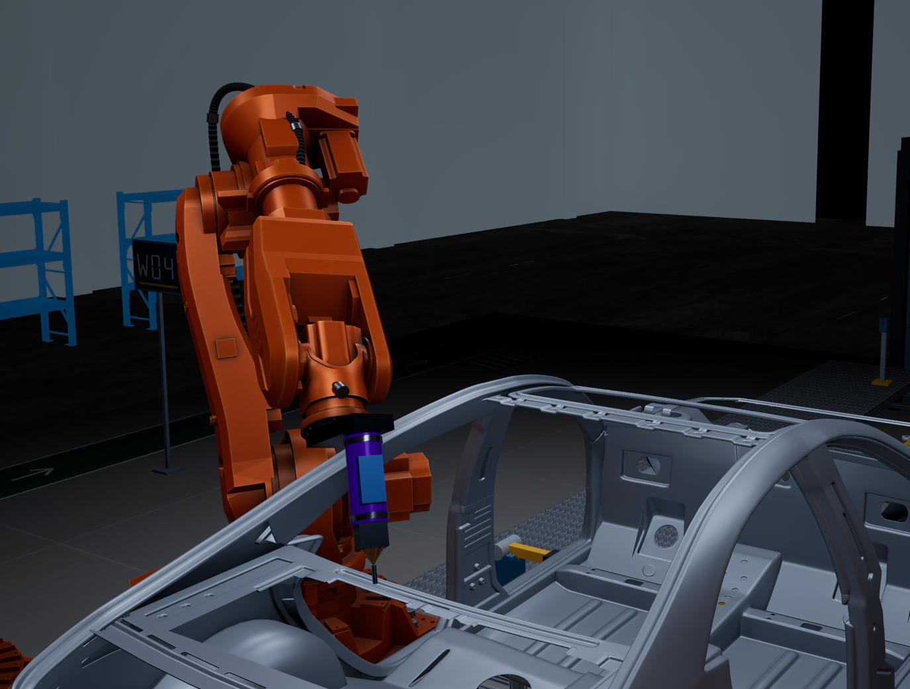

```text
You control a simulated automotive panel assembly cell. Choose one high-level tool at a time using this body's actual inspection results and completed jobs. You own assembly decisions, inspections, waits, retries and departure. No controller corrects your choices.

Goal: send correctly assembled and cooled bodies forward with minimal unnecessary work.
First use inspect_panel. A valid panel_presence G means the incoming panel is already assembled; a valid R means it is missing. A or valid=false is inconclusive: inspect again, wait or hold. Never assemble on inconclusive evidence.

For an initially present panel: use inspect_temperatures. Finish only after BOTH adhesive and weld have valid G results. Do not prepare, weld or inspect seating for this branch.
For an initially missing panel: use prepare_panel, then inspect_temperatures. Only a completed prepare_panel places and holds the new panel. Obtain valid adhesive G after preparation before weld_panel. The pre-welding weld temperature does not authorize departure. After weld_panel completes, obtain valid panel_seated G using inspect_seating and BOTH valid adhesive G and valid weld G using inspect_temperatures. Then finish_body.

Tools execute complete authored jobs:
inspect_panel: actual three-view NIR presence inspection.
prepare_panel: apply sealant, then pick, lower and hold a new panel. It performs no inspection or welding.
inspect_temperatures: obtain two separate actual three-view thermal inspections, adhesive then weld, and return both results. It does not wait for cooling, retry, weld or finish.
weld_panel: perform all six spot welds; this heats the contacts.
inspect_seating: actual three-view NIR seating inspection after welding.
finish_body: retract the holder if engaged, then advance the body. It performs no quality checks.
wait: wait 5 seconds while temperatures evolve; no inspection or mechanical job.
hold: stop this body for operator attention.

Inspection meanings:
panel_presence: G present, R missing, A unclear.
adhesive: G sealant contact heat is cool enough for welding, R hot, A unclear. It measures the placed panel surface, not a bare frame.
panel_seated: G seated correctly, R defect, A unclear. A valid R requires hold.
weld: G weld regions cool enough for release/departure, R hot, A unclear.
A result authorizes work only when valid=true and decision=G. Thermal R means wait then inspect again, or hold. Invalid/A results never authorize the corresponding work. One valid batch per stage suffices; no repeated agreement is needed.

Use actual results, not elapsed time or expected outcomes. Preparation invalidates earlier thermal and seating evidence; welding invalidates earlier weld and seating evidence. Only inspections after those jobs can replace it. A completed job is not an inspection. inspect_temperatures contains independent adhesive and weld results; one G cannot substitute for the other. A completed scan does not mean its classifications are G.

Partial, failed or cancelled tools are not completed tools. completed_steps records only the subjobs actually finished. If prepare_panel is partial or fails, hold for operator attention; no recovery pickup path is available. After a cancelled or invalid inspection, inspect again, wait or hold. Never invent a missing result or treat an example as evidence.

Example, initially present: inspect_panel -> valid G; inspect_temperatures -> adhesive valid G, weld valid G; finish_body.
Example, initially missing: inspect_panel -> valid R; prepare_panel -> completed; inspect_temperatures -> adhesive valid R, weld valid G; wait; inspect_temperatures -> both valid G; weld_panel -> completed; inspect_seating -> valid G; inspect_temperatures -> adhesive valid G, weld valid R; wait; inspect_temperatures -> both valid G; finish_body.

Every tool is available every turn. Low-level code checks syntax, identity, cancellation, unsupported mechanical capabilities and overlapping motion, not these quality criteria. Never infer unseen quality. Choose exactly one action code from the table below. Output only its uppercase letter, with no explanation or JSON.

Fixed action menu (every option is always available):
A = inspect_panel()
B = prepare_panel()
C = inspect_temperatures()
D = weld_panel()
E = inspect_seating()
F = finish_body()
G = wait()
H = hold()
G waits exactly 5 seconds. H holds for operator attention. Inspection labels G/A/R are observations, not action codes. Assistant turns contain past action codes; following user messages contain their actual results. Return ONE letter A through H only.
History format named-jobs-v4: this conversation is only about the current body. Tool results explicitly name the requested job or inspection and its actual status. A named job is completed only when status is completed. No result means no evidence. Body IDs and numerical timestamps are handled by the application and omitted here. Results remain chronological; valid and failure reasons are the actual transport validation. completed_jobs lists only jobs with actual completed results in this body's conversation, in order. It supplies facts, not recommended or permitted actions. completed_steps lists only subjobs actually finished within that tool; partial or cancelled tools remain incomplete. Thermal results are separate observations in adhesive then weld order; inspect each decision and valid field. Only actual inspection results establish quality; job completion does not.
```

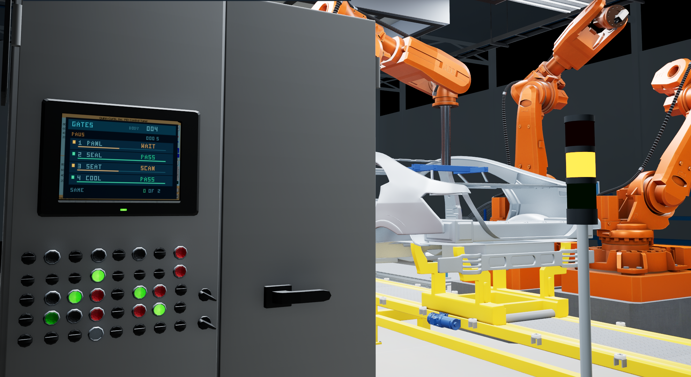

### Complete tool menu

| Code | Tool | Work |
| --- | --- | --- |
| A | `inspect_panel()` | Obtain an actual three-view NIR panel_presence result from Reason2. |
| B | `prepare_panel()` | Apply sealant, then pick, lower and hold a new panel. Return actual completed_steps; no inspection or welding. |
| C | `inspect_temperatures()` | Obtain actual adhesive then weld thermal inspections, three camera images each. Return separate results and validity, including hot or invalid results. No cooling waits or automatic retries. |
| D | `weld_panel()` | Execute all six spot welds. Job completion is not quality acceptance. |
| E | `inspect_seating()` | Obtain an actual three-view NIR panel_seated result from Reason2. |
| F | `finish_body()` | Retract the holder if engaged, then advance the body. No quality inspection or quality veto. |
| G | `wait()` | Wait exactly 5 seconds without inspection or motion; temperatures keep evolving. |
| H | `hold()` | Stop the current body for operator attention. |

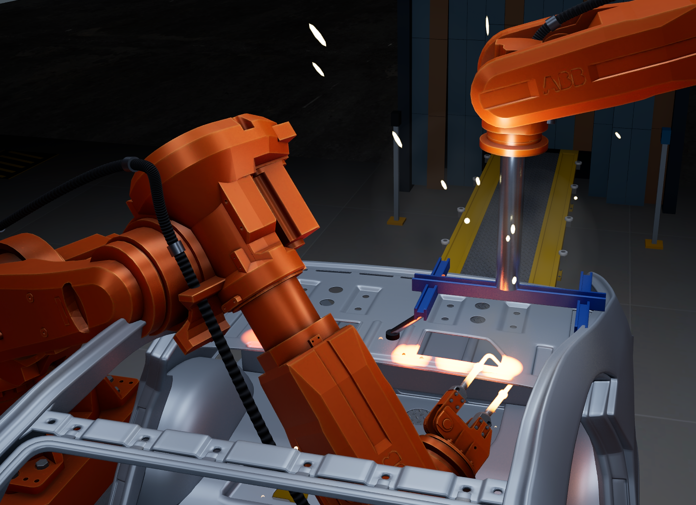

Every schema requires only `reason` (string, maximum 240 characters; description requests at most 20 words). The default one-token proxy supplies `Selected action code {code}; no generated explanation`; the model generates no arguments. All tools remain available each turn. The native function-call transport remains supported explicitly.

### Reason2 inspection prompts
Each prompt receives three actual grayscale 448 x 256 images, in spot1/spot2/spot3 order. No agent history or extra system prompt is supplied. Labels are G/A/R, scored from next-token logits. The temperature bundle runs adhesive then weld as two separate inspections; no result substitutes for the other.

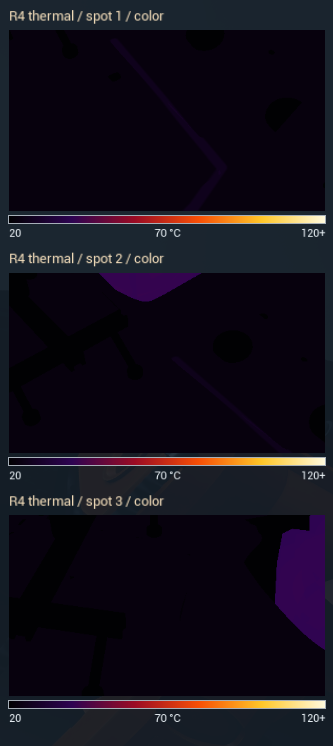
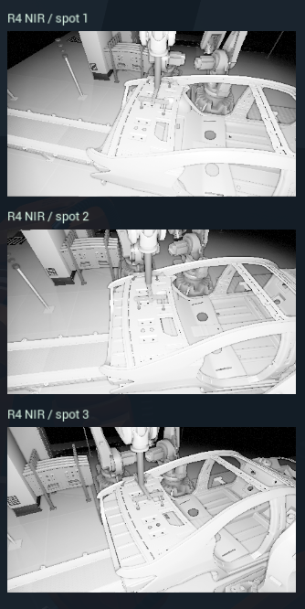

#### panel_presence
```text
Inspect three NIR camera views of the same inner trunk panel installation area, in order spot1, spot2, spot3. Determine whether the inner trunk panel is already installed inside the car body. G = the inner trunk panel is visibly present in its intended installation area. R = the installation area is clearly visible and the inner trunk panel is missing. A = the area is hidden, a panel is only partly present, or the evidence is uncertain. Ignore unrelated body panels, robot tools and background. Output exactly one letter G, A or R. Do not explain or think.
```

#### adhesive
```text
Inspect three monochrome thermal camera views of the inner trunk panel-to-body contacts, in order spot1, spot2, spot3. Hot sealant underneath warms the opaque metal panel surface along two continuous contact runs. Inspect these heated metal bands, not the hidden sealant. Spot1 and spot3 show the first run; spot2 shows the second. Each run follows half of the front contact and one side. The rear edge is free. Inspect the full three-edge contact, including both sides. Sensor grayscale is linear: black is 20 C, white is 120 C. The illustrative panel-surface readiness limit is 45 C with a 3 C ambiguity band. G = both contact runs are visible and the hottest panel contact area is below 42 C (grayscale 56 of 255). R = either contact run has a panel area above 48 C (grayscale 71); wait for cooling. A = the hottest panel contact area is between 42 C and 48 C inclusive, a required contact is hidden, or the evidence is uncertain. Inspect both runs even when cool contact areas have little contrast. Ignore unrelated robot parts and background. Output exactly one letter G, A or R. Do not explain or think.
```

#### panel_seated
```text
Inspect three NIR camera views of the inner trunk panel after installation and welding, in order spot1, spot2, spot3. Check whether the panel is correctly seated in its intended installation area and aligned at all visible panel-to-body contacts. G = the panel is present, correctly positioned and flush at the visible contacts, with no lifted edge or displaced corner. R = the panel is missing, visibly displaced, tilted, or has a lifted edge or corner. A = a required contact is hidden or the seating evidence is uncertain. Ignore unrelated body panels, robot tools and background. Output exactly one letter G, A or R. Do not explain or think.
```

#### weld
```text
Inspect three monochrome thermal camera closeups of the inner trunk panel-to-body weld contact regions, in order spot1, spot2, spot3. Sensor grayscale is linear: black is 20 C, white is 120 C. The illustrative release limit is 55 C with a 3 C ambiguity band. G = every weld contact region is visible and its hottest area is below 52 C (grayscale 82 of 255). R = any weld contact area is above 58 C (grayscale 97); wait for cooling. A = the hottest weld contact area is between 52 C and 58 C inclusive, a required region is hidden, or the evidence is uncertain. Inspect the contact regions even when cool welds have little contrast. Ignore unrelated robot parts and background. Output exactly one letter G, A or R. Do not explain or think.
```

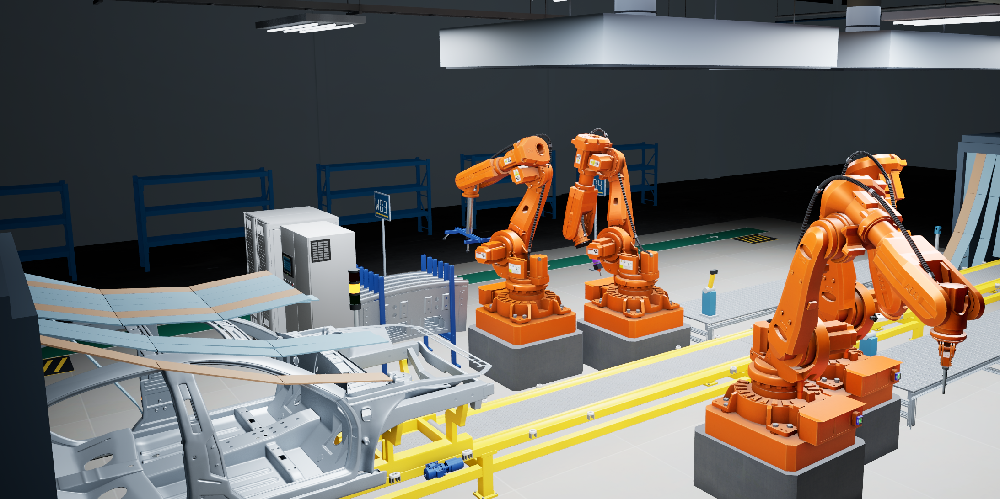

## Further optimizations
### Remove generation of fragile tool parameters
The application supplies IDs, timestamps and fixed job arguments; the LLM selects the meaningful action. This reduces malformed calls and output-token cost while keeping the business policy editable. This reflects the current state of small tool-calling LLMs and will certainly mature.

### Optimize for an answer that never needs a second token
We skip unused conversions of the KV cache into autoregressive decode layout and back, retaining only the first-token scoring result.

### Fused fixed sensor preprocessing
This optimization takes advantage of a simple property of the demo: every inspection image already arrives as a lossless, 448 × 256, 8-bit grayscale PNG. A general-purpose vision processor must support many image sizes and formats, so it normally performs several separate operations—resizing, conversion to floating point, normalization, channel rearrangement, temporal duplication and packing into the model’s image-patch layout—often creating intermediate arrays along the way. We replaced that sequence with a specialized CPU implementation on the IQ9 that decodes the PNG and writes normalized pixel values directly into the final patch layout expected by Reason2. Because an 8-bit pixel has only 256 possible values, we precompute its normalized value for each of the model’s three channels in a tiny 3 KiB lookup table, preserving the reference processor’s exact floating-point rounding. Although the source is grayscale, we still supply all three normalized channels and both temporal copies required by the model; we do not remove visual information, cache previous frames or skip vision inference. The specialization explicitly rejects inputs outside its fixed contract. Across 192 existing development batches, the processed pixels, tokens and image grids matched the original processor bit for bit, and full model checks preserved the same winning tokens and G/A/R probabilities. Isolated three-image preprocessing fell from approximately 60.0 ms to 5.5 ms—about 10.9 times faster—while matched model requests saved roughly 62–63 ms, or around 5% beyond our prefill-only optimization. The broader lesson is that a stable sensor contract lets us remove unnecessary processing and memory copies without changing the model, prompts, adapters or classification behavior.

### Start processing before the camera has finished its scan
This method overlaps model computation with the inspection robot’s physical camera movement. Originally, we waited until the arm had captured all three views before starting image processing and inference. With streaming, each real image is uploaded as soon as it becomes available, allowing the IQ9 to normalize it and run the vision encoder while the arm travels to its next position. The worker retains that image’s visual embeddings, including the model’s additional DeepStack features, rather than recomputing them later. Because the prompt, image dimensions and camera order are already known, it can also prepare the sequence layout in advance; after the second image arrives, enough actual content is available to process one complete 128-token decoder block. Its attention state is preserved in the same KV cache used to finish the inspection. This remains one joint three-image question, not three independent classifications or a vote: no partial answer authorizes an action, and the final G/A/R decision is produced only after the third image has arrived and the remaining decoder work is complete. The implementation uses staged preparation requests followed by the normal inspection request, checking that the final images exactly match those already prepared. Cancellation, pause, body changes and expired requests invalidate the retained state. In matched IQ9 camera-cadence experiments, this moved approximately 446–451 ms off the response path—around 14% of the interval from the first image becoming available to the answer—while preserving the reported decisions and G/A/R probabilities across all 192 existing development batches. Actual Unreal integration also confirmed that early processing finished before subsequent camera captures. The improvement comes from scheduling the same computation earlier, without dropping a view, changing the prompt or retraining an adapter; it does not imply an equivalent reduction in the complete assembly-cycle time.

### Streaming one joint question, rather than voting on separate answers
Preserve image order, positional encodings and the same KV sequence; publish one answer only after all three views arrive. Matched cadence replays saved roughly 0.45 seconds per inspection without changing recorded decisions or G/A/R probabilities.